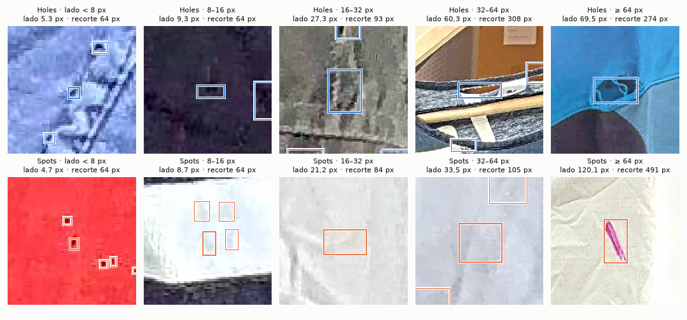
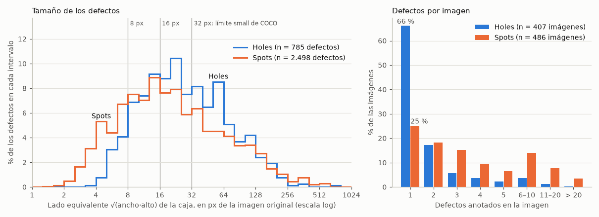
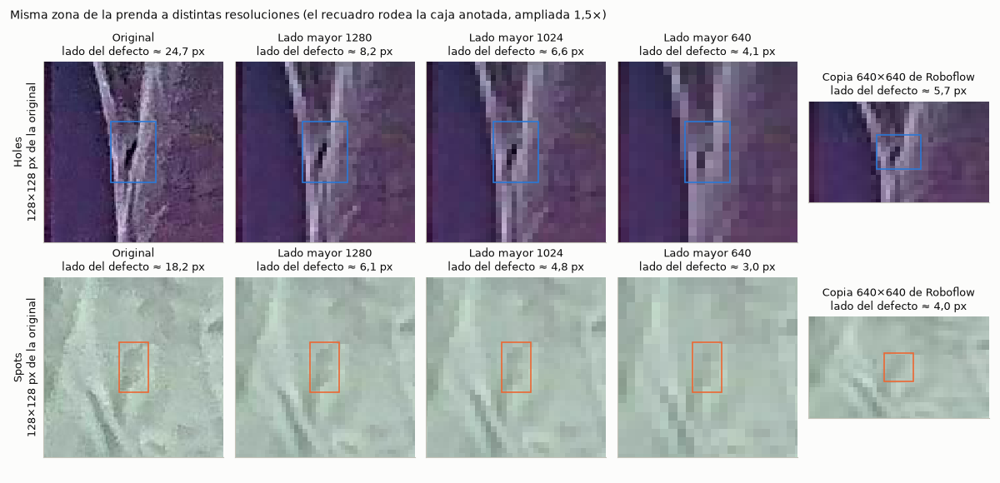

# EDA de CISUTAC Holes + Spots

Bloque de la Integrante 1 del [plan de EDA](../../notes/PLAN_EDA_REWEAR_AI.md#integrante-1--cisutac-prendas-usadas-y-tamaño-real-de-los-defectos). Sólo lee datos: no modifica imágenes, etiquetas ni splits oficiales. Al final se agrega un [baseline preliminar](#baseline-preliminar-foto-completa-a-640-sólo-valid), entrenado con el split propuesto y evaluado sólo en valid.

**Regenerar todas las tablas y figuras** (unos 8 segundos; sólo requiere `data/cisutac_holes` y `data/cisutac_spots`, o `REWEAR_DATA_DIR`):

```bash
python scripts/generate_cisutac_eda.py
```

**Decisiones del equipo aplicadas:**

- Todo el análisis y los conteos usan la **versión original** de cada captura (2160×3840 salvo 3 excepciones). La copia de 640×640 se documenta en CIS-1 y sólo se usa en CIS-4 como ejemplo real de resize, en los pares cuyas cajas coinciden.
- Los resultados viven en `src/eda_utils.py` y en esta carpeta. El notebook principal lo integra la Integrante 4.

### Revisión y decisiones aprobadas — 11 de noviembre de 2026

- Se validó la unidad experimental y se aprobó usar exclusivamente **407 capturas originales / 785 agujeros** y **486 capturas originales / 2.498 manchas**. Las copias de 640×640 no son observaciones independientes.
- Se aprobó como **split CISUTAC v1** el manifiesto `cis5_split_propuesto.csv`: Holes 300/43/64 y Spots 361/59/66 capturas en train/valid/test. La revisión confirmó que no comparte capturas, fechas ni IDs de sesión/prenda entre particiones. El manifiesto queda congelado antes del entrenamiento y los originales no se modifican.
- Se aprobó el experimento posterior **foto completa con lado mayor 640 vs. entrenamiento e inferencia por tiles**, comenzando con tiles de 640 y 20 % de solapamiento. Los parámetros alternativos se eligen sólo con valid; el test se reserva para la medición final.
- Esta aprobación no convierte la simulación geométrica en un resultado de detección: la mejora en `AP_small` y recall debe medirse con modelos entrenados bajo cada protocolo. El baseline preliminar de este documento no es el resultado final.
- Limitación residual: la revisión visual de identidad no es exhaustiva. Si aparece una misma prenda en días distintos, debe versionarse el manifiesto antes del entrenamiento final, sin usar resultados de test para decidir el cambio.

## Resumen para el equipo

- **Unidad real de análisis:** 407 capturas con 785 agujeros y 486 capturas con 2.498 manchas, en versión original. Casi la mitad de los archivos (354 y 420) son copias de 640×640 de las mismas fotos (CIS-1).
- **Los defectos son chicos aun a resolución completa:** lado mediano de 25 px en Holes y 18 px en Spots, en fotos de 2160×3840. Son *small* de COCO el 58 % y el 67 %, respectivamente (CIS-3).
- **El resize a 640, la entrada por defecto de YOLO, los vuelve casi invisibles:** lado mediano de 4,2 y 3,0 px. El 71 % y el 77 % quedan bajo 8 px, menos que una celda de stride 8. Con tiles de 640 y 20 % de solapamiento conservan su tamaño, a cambio de unas 32 veces más píxeles procesados (CIS-4).
- **Incluso un detector perfecto que sólo se corre 1 px tendría a 640 un recall de apenas 39 % y 30 %** a IoU 0,5. A resolución nativa, ese mismo error daría 98 % y 88 % (CIS-6). **Esto justifica evaluar el tiling como experimento central; su beneficio todavía debe medirse.**
- **Los defectos son difíciles por tamaño y por contraste.** Las anotaciones parecen exhaustivas, incluso en puntos de 3–4 px, y no hay duplicados exactos (CIS-2).
- **El split oficial no es independiente.** Train y valid comparten días y al menos una prenda, porque el código hex identifica una sesión de fotos y no la prenda física. Además, el tamaño de los defectos cambia con el tiempo, así que un test por fecha no tendría defectos chicos. Se aprobó el **split CISUTAC v1**, agrupado por día y con una distribución de tamaños comparable (CIS-5).
- **Métricas propuestas:** mAP@0.5, mAP@0.5:0.95, precisión/recall/F1, AP_small **en coordenadas originales**, recall por rango de tamaño y tiempo por imagen, con intervalos por bootstrap (CIS-6).
- **Baseline preliminar (YOLO11n, foto completa a 640, sólo valid): no encuentra ningún defecto de menos de 32 px**, que son la mitad de los agujeros y el 70 % de las manchas de valid. Da mAP@0.5 de 0,032 (Holes) y 0,019 (Spots), con AP_small de 0. Correr ese mismo modelo con tiles tampoco alcanza: aparece algún defecto chico, pero suben los falsos positivos y baja el mAP. **El experimento de tiling tiene que entrenar con tiles**, no sólo inferir con ellos.

## CIS-1 — Estructura, unidades y splits

**Pregunta:** ¿qué hay realmente en CISUTAC y cuál es la unidad de análisis?

### Unidades

| Unidad | Cómo se identifica |
|---|---|
| Archivo | Cada imagen exportada por Roboflow (`…_png.rf.<hash>.jpg`) |
| Captura | Nombre antes de `.rf.`: `<fecha>_<hora>_<id>_<vista>_nobg_png` |
| Prenda | Código hexadecimal de 8 caracteres del nombre (`id`). En rigor identifica una sesión de fotos de la prenda: si se vuelve a fotografiar, recibe otro código (ver CIS-5) |
| Instancia | Una fila del label YOLO (caja o polígono) |

### Inventario

Tabla completa con controles de integridad: [`cis1_inventario.csv`](cis1_inventario.csv).

| Dataset | Split | Archivos | Originales | Copias 640 | Capturas | Prendas | Instancias, todas las copias | **Instancias, original** | Polígonos, original |
|---|---|---:|---:|---:|---:|---:|---:|---:|---:|
| Holes | train | 697 | 375 | 322 | 375 | 374 | 1.369 | **721** | 2 |
| Holes | valid | 64 | 32 | 32 | 32 | 32 | 128 | **64** | 0 |
| Holes | total | 761 | 407 | 354 | 407 | 406 | 1.497 | **785** | 2 |
| Spots | train | 830 | 448 | 382 | 448 | 448 | 4.265 | **2.242** | 37 |
| Spots | valid | 76 | 38 | 38 | 38 | 38 | 512 | **256** | 13 |
| Spots | total | 906 | 486 | 420 | 486 | 486 | 4.777 | **2.498** | 50 |

### Hallazgos

1. **Cada captura aparece hasta dos veces.** Roboflow exportó la foto original y, en 354/407 capturas de Holes y 420/486 de Spots, una copia de 640×640. Las 53 y 66 capturas sin copia están todas en train. Por eso los 761/906 «imágenes» y las 1.497/4.777 instancias de la auditoría cuentan ambas versiones. **La base real de análisis es 407 capturas / 785 agujeros y 486 capturas / 2.498 manchas.**
   - **El origen está confirmado por el historial del repositorio en Hugging Face** (commits de `wargoninnovation/Garment_condition_holes` y `_spots`). La página de la versión en Roboflow no es accesible.
     - El **10/04/2026** se subieron sólo las versiones de 640×640: 354 y 420 capturas, de unos 30 KB por archivo.
     - El **21/04** se agregaron las originales en resolución completa de esas mismas capturas (unos 500 KB por archivo).
     - El **21/05** se agregó el lote de mayo (53 y 66 capturas), sólo en resolución completa.

     Por eso conviven las dos versiones y las capturas de mayo no tienen copia.
2. **La copia de 640×640 es la misma foto estirada, sin recorte ni espejado** (verificado visualmente en 4 pares). El reescalado no conserva la proporción: ×0,296 en horizontal (2160→640) y ×0,167 en vertical (3840→640), así que los defectos además se achatan. Emparejando caja a caja (tolerancia de 2 px en la grilla de 640), las cajas coinciden en **353/354 pares de Holes y 417/420 de Spots**. En los 4 restantes cambia el número de cajas: por ejemplo, 7 agujeros chicos del original aparecen como 3 cajas en la copia, una de ellas englobando un grupo.
3. **Resoluciones:** 406/407 originales de Holes y 484/486 de Spots son 2160×3840 (vertical). Las excepciones son vistas traseras: 1 de 1920×1080 en Holes y 2 de 1080×1920 en Spots. Ninguna imagen tiene rotación EXIF, así que las cajas YOLO se dibujan directo sobre los píxeles.
4. **Categorías:** según `data.yaml`, una sola clase por dataset (`Hole`, `Spot`). Holes y Spots son tareas separadas.
5. **Sin normales ni test:** 0 imágenes sin instancias y 0 labels faltantes. `data.yaml` declara `test: ../test/images`, pero la carpeta no existe en la descarga.
6. **Integridad de las etiquetas:** 0 filas malformadas, 0 coordenadas fuera de [0, 1] y 0 labels sin imagen. Ningún `.txt` termina con salto de línea: no afecta a lectores línea a línea, pero `cat *.txt | wc -l` subcuenta.
7. **Prendas y vistas:** Holes tiene 406 prendas en 407 capturas (la prenda `0a87b549` tiene vista delantera y trasera, ambas en train). En Spots hay una captura por prenda. Casi todas las capturas son delanteras: 1 trasera en Holes y 2 en Spots. Ningún código hex está a la vez en train y valid, pero CIS-5 muestra que una misma prenda puede reaparecer con otro código.

### Diferencias con `dataset_audit.md`

- Contando ambas versiones, se reproducen los conteos y las medianas de área relativa de la auditoría: 0,00697 % en Holes y 0,00385 % en Spots.
- En Spots, la auditoría da 4.712 instancias bajo el 1 % porque usa el área poligonal en las 99 filas con polígono. Con área de caja, como pide C0.3, son 4.710. Ambas áreas se guardan por separado.
- Con sólo originales, la mediana preliminar es 0,00749 % en Holes y 0,00401 % en Spots. Los percentiles completos van en CIS-3.

### Limitaciones e implicancias

- **Valid es muy chico:** 32 prendas en Holes y 38 en Spots. Una métrica en valid tendrá mucha varianza; la propuesta de test independiente va en CIS-5.
- Entrenar con todos los archivos tal como vienen mezclaría dos escalas de la misma foto y daría doble peso a las capturas con copia. Recomendación para el baseline: usar sólo los originales.
- **Para la integración (Integrante 4):** `dataset_audit.md` y `notes/AGENTS.md` mencionan 761/906 imágenes y 1.497/4.777 instancias. Son conteos de archivos con copias, no de fotos distintas. No se modificaron esos documentos compartidos.
- **Observación de dominio (para INT-2):** las fotos tienen el fondo difuminado artificialmente (`nobg` en el nombre) y la prenda colgada en una percha.

### Tabla por instancia

[`instancias_original.csv`](instancias_original.csv) tiene una fila por instancia de las versiones originales: 785 de Holes y 2.498 de Spots. Es la base de CIS-2 a CIS-4.

| Columna | Significado |
|---|---|
| `dataset`, `split`, `captura`, `prenda`, `version` | Procedencia de la instancia |
| `img_ancho`, `img_alto` | Tamaño de la imagen original en píxeles |
| `tipo` | `caja` o `poligono` (los polígonos se resumen con su caja envolvente) |
| `x_centro`, `y_centro`, `ancho_rel`, `alto_rel` | Caja en formato YOLO normalizado |
| `ancho_px`, `alto_px`, `area_caja_px` | Caja en píxeles de la imagen original |
| `area_caja_rel` | Área de la caja / área de la imagen |
| `area_poligono_px` | Área del polígono en píxeles (vacío si es caja); no se mezcla con `area_caja_px` |
| `coords_validas` | Coordenadas dentro de [0, 1] y caja de tamaño positivo |

## CIS-2 — Ejemplos con cajas y calidad de las etiquetas

**Pregunta:** ¿cómo se ven los defectos en las fotos reales y qué tan confiables son las cajas?

**Cómo se eligieron los ejemplos:** con semilla fija (`SEED = 2026` en el script) y sólo entre imágenes de train y valid propuestos. El test no se usó para mirar ejemplos.

### Figuras

1. **[`cis2_ejemplos_imagenes.jpg`](cis2_ejemplos_imagenes.jpg): imágenes completas con sus cajas.** Por dataset se muestran tres casos: uno fácil (1–2 defectos, todos de lado ≥ 64 px), uno difícil (hasta 3 defectos, alguno de lado < 8 px) y uno con 10 defectos o más. Un círculo marca los defectos de lado < 32 px, que a esta escala no se ven.
2. **[`cis2_zoom_por_tamano.png`](cis2_zoom_por_tamano.png): un defecto por rango de tamaño, a resolución completa.** Se dibujan también las demás cajas de la imagen que caen en el recorte.
3. **[`cis2_cajas_finas.png`](cis2_cajas_finas.png): revisión de cajas con algún lado < 4 px.** Son 12 al azar de Spots y las 4 de Holes que hay en train y valid.



### Controles automáticos

Tabla completa: [`cis2_controles_etiquetas.csv`](cis2_controles_etiquetas.csv).

| Control (sólo versiones originales) | Holes | Spots |
|---|---:|---:|
| Pares de cajas con IoU ≥ 0,5 en una misma imagen (posible duplicado) | 1 | 0 |
| Pares de cajas que se tocan (0 < IoU < 0,5) | 7 | 196 |
| Pares de cajas anidadas | 0 | 2 |
| Cajas con algún lado < 4 px | 6 | 227 |
| Capturas con alguna de esas cajas | 5 | 61 |

### Hallazgos

1. **A escala de la foto completa, los defectos chicos no se ven.** Sólo los agujeros grandes se reconocen sin ampliar. Esto refuerza la conclusión de CIS-4.
2. **Las cajas son ajustadas y la anotación parece exhaustiva.** En recortes con muchos puntitos (la tela roja o la oscura), casi todos tienen su caja, incluso los de 3–4 px.
   - En la muestra de cajas finas, 11 de 16 rodean un punto o corte visible y 5 son apenas perceptibles. Las 227 cajas diminutas de Spots parecen anotaciones deliberadas de manchas reales, no ruido.
   - En la muestra no se ve con claridad ningún punto parecido sin caja, aunque en los recortes con muchos puntos es difícil asegurarlo.
3. **La dificultad no es sólo de tamaño, también de contraste.** Muchas manchas son grises tenues sobre tela clara (la de 33,5 px casi no se distingue) y varios agujeros sobre tela oscura apenas se ven. Al detector le van a costar incluso a resolución completa.
4. **Hay defectos agrupados.** Spots tiene 196 pares de cajas que se tocan (manchas en racimo) y en Holes hay una remera con 30 agujeros. La supresión de no máximos (NMS) y la fusión de detecciones entre tiles pueden unir o eliminar detecciones vecinas, así que conviene revisarlo en el análisis de errores.
5. **Algunas manchas tienen colores vivos y forma de trazo:** la línea rosa del ejemplo ≥ 64 px, o las marcas rojas y verdes de la remera amarilla de CIS-5. Son compatibles con manchas aplicadas a propósito. El README del dataset habla de prendas posconsumo y no lo aclara. Si fuera así, su apariencia podría diferir de la de manchas de uso real; queda como observación, no como hallazgo confirmado.
6. **Hay una posible caja duplicada en Holes** (IoU 0,68 en `20260224_092807_f33c0705`). No se modifica la anotación; su efecto en las métricas es mínimo.

## CIS-3 — Distribución de defectos

**Pregunta:** ¿qué tamaño real tienen los defectos, en píxeles de la foto original, y cuántos hay por imagen?

Todas las medidas usan la versión original y la caja anotada, salvo que se indique otra cosa. El **lado equivalente** es √(ancho·alto): el lado del cuadrado con la misma área que la caja. Los percentiles se calculan con interpolación lineal (igual que `numpy.percentile`).



### Percentiles

Tabla completa, con mínimos y máximos: [`cis3_cuantiles.csv`](cis3_cuantiles.csv).

| Medida | Holes: p10 / p50 / p90 | Spots: p10 / p50 / p90 |
|---|---|---|
| Defectos por imagen | 1 / 1 / 4 (máx. 30) | 1 / 3 / 11,5 (máx. 80) |
| Ancho de la caja (px) | 8,5 / 23,4 / 91,9 | 4,9 / 18,2 / 99,8 |
| Alto de la caja (px) | 8,1 / 26,3 / 130,4 | 4,7 / 18,7 / 121,0 |
| **Lado equivalente (px)** | **8,9 / 24,7 / 100,0** | **4,9 / 18,2 / 103,6** |
| Área de la caja (px²) | 80 / 612 / 10.000 | 24 / 331 / 10.730 |
| Área relativa (% de la imagen) | 0,00096 / 0,0075 / 0,12 | 0,00029 / 0,0040 / 0,13 |
| Relación de aspecto (ancho/alto) | 0,38 / 0,92 / 1,88 | 0,44 / 0,94 / 2,13 |

### Porcentaje de defectos bajo cada umbral

Medido en la imagen original: [`cis3_umbrales.csv`](cis3_umbrales.csv).

| Umbral | Holes (n = 785) | Spots (n = 2.498) |
|---|---:|---:|
| Lado equivalente < 8 px | 8,0 % | 21,9 % |
| Lado equivalente < 16 px | 31,5 % | 45,3 % |
| COCO small: área < 32² px | **58,2 %** | **66,8 %** |
| COCO medium: 32² ≤ área < 96² px | 31,5 % | 22,1 % |
| COCO large: área ≥ 96² px | 10,3 % | 11,1 % |
| Lado menor (mín. de ancho y alto) < 4 px | 0,8 % | 9,1 % |
| Lado menor < 8 px | 13,0 % | 29,1 % |
| Área relativa < 0,01 % | 54,6 % | 64,0 % |
| Área relativa < 1 % | 99,6 % | 98,6 % |

### Hallazgos

1. **Los defectos son chicos incluso a resolución completa.** El lado mediano es de 25 px en Holes y 18 px en Spots, en fotos de 2160×3840. Más de la mitad son *small* según COCO aun medidos en la imagen original (58 % y 67 %). Cualquier resize de la foto completa los achica todavía más: es el punto de partida de CIS-4.
2. **Spots tiene más defectos diminutos.** El 22 % mide menos de 8 px de lado, contra el 8 % en Holes. Además, el 9 % de las manchas tiene algún lado menor a 4 px (la caja más fina mide 0,9 px). Esos casos extremos se revisan a ojo en CIS-2 para distinguir manchas reales de ruido de anotación.
3. **El rango de tamaños es enorme:** de 1 a 760 px de lado, casi tres órdenes de magnitud. Un promedio global mezclaría defectos de 3 px con defectos de 700 px, así que las métricas tienen que desagregarse por tamaño (CIS-6).
4. **Agujeros y manchas se distribuyen distinto por imagen.** El 66 % de las imágenes de Holes tiene un solo agujero. En Spots, la mediana es de 3 manchas por imagen, el 10 % tiene 12 o más y hay una con 80. Con muchas manchas cercanas, la fusión de detecciones entre tiles solapados (por ejemplo, en SAHI) va a pesar más en Spots.
5. **Las cajas son casi cuadradas en la mediana, pero hay muchas alargadas.** La relación ancho/alto va de 0,4 a 2 entre p10 y p90. Esto importa en CIS-4: la copia de 640×640 comprime 1,78 veces más en vertical que en horizontal.
6. **Las cajas sobrestiman el área de las manchas irregulares.** En los 50 polígonos de Spots, el área del polígono es en mediana el 57 % de la de su caja (p10: 32 %). Por lo tanto, los umbrales medidos sobre cajas son conservadores: el defecto real suele ser más chico. Los polígonos son pocos (2 en Holes, 50 en Spots) y no permiten métricas de segmentación.
7. **Comparación con la auditoría:** con sólo originales, la mediana del área relativa es 0,0075 % en Holes y 0,0040 % en Spots. La auditoría daba 0,00697 % y 0,00385 % contando ambas copias. Bajo el 1 % del área quedan el 99,6 % y el 98,6 % de los defectos.

### Implicancias

- **Propuesta de definición para CIS-6:** «defecto pequeño» = lado equivalente < 32 px en la imagen original, es decir, *small* de COCO medido en coordenadas originales. Opcionalmente, «diminuto» = lado < 16 px. Las dos definiciones deben fijarse antes de entrenar.
- **Holes y Spots se evalúan por separado:** tienen distinta densidad por imagen y distinta proporción de defectos diminutos.

### Limitaciones

- **Los percentiles son por defecto, no por imagen:** las imágenes con muchas manchas pesan más (la de 80 manchas aporta el 3 % de las instancias de Spots).
- **Es la distribución de todos los días juntos.** El tamaño cambia con la fecha (ver CIS-5), y los splits propuestos se eligieron para conservar esta distribución.

## CIS-4 — Simulación de resize (sin entrenar)

**Pregunta:** si se achica la foto completa al tamaño de entrada habitual de un detector, ¿cuántos píxeles le quedan a cada defecto? ¿Cuánto cuesta evitarlo con tiles?

### Método

- **Resizes simulados:** cada caja se reescala con el mismo factor que la imagen.
  - Lado mayor 1280, 1024 o 640, conservando la proporción. Es lo que hace el *letterbox* de YOLO; 640 es el tamaño por defecto de los modelos de Ultralytics que usamos en clase (YOLO11, YOLO26).
  - El estirado a 640×640 de la copia de Roboflow.
- **Validación con la copia real:** en los pares cuyas cajas coinciden (353 capturas y 709 cajas en Holes, 417 y 2.162 en Spots), las cajas de la copia real difieren de las calculadas en **0,12 px de mediana** (máximo 1,24 px). La simulación reproduce lo que hizo Roboflow.
- **Datos:** se usan todas las versiones originales (785 y 2.498 defectos). La fila de la copia real usa sólo los pares coincidentes. Las 3 originales que no son de 2160×3840 se escalan con su tamaño real.

### Tamaño de los defectos a cada resolución de entrada

Tabla completa: [`cis4_resize.csv`](cis4_resize.csv). «Lado» es el lado equivalente √(ancho·alto) en px de la imagen que recibe el modelo.

| Entrada al modelo | Holes: lado mediano | Holes: % < 8 px | Holes: % < 4 px | Spots: lado mediano | Spots: % < 8 px | Spots: % < 4 px |
|---|---:|---:|---:|---:|---:|---:|
| Original (2160×3840) | 24,7 | 8,0 | 0,1 | 18,2 | 21,9 | 5,4 |
| Lado mayor 1280 (720×1280) | 8,3 | 48,2 | 20,5 | 6,1 | 59,0 | 34,5 |
| Lado mayor 1024 (576×1024) | 6,6 | 56,1 | 30,1 | 4,9 | 65,2 | 42,6 |
| **Lado mayor 640 (360×640)** | **4,2** | **71,2** | **48,2** | **3,0** | **76,7** | **59,0** |
| 640×640, copia real | 5,2 | 65,7 | 38,5 | 4,1 | 70,4 | 48,8 |

- **Con la entrada por defecto de YOLO (lado mayor 640),** la mitad de los agujeros queda con menos de 4,2 px de lado y la mitad de las manchas con menos de 3 px. Además, el 27,6 % de los agujeros y el 43 % de las manchas quedan con algún lado menor a 2 px.
- **Relación con el stride.** En los detectores tipo YOLO, la salida más fina tiene stride 8: por la fórmula de salida de una convolución vista en clase, ⌊(H + 2p − k)/s⌋ + 1, cada celda de esa grilla resume 8×8 px de la entrada. A 640, el 71 % de los agujeros y el 77 % de las manchas ocupan menos que una celda.
- **Subir la resolución ayuda poco:** incluso a 1280, quedan bajo 8 px el 48 % de los agujeros y el 59 % de las manchas.
- **La copia de 640×640 deforma los defectos.** Comprime 6 veces en vertical y 3,4 en horizontal: en Holes, el ancho mediano queda en 6,5 px y el alto en 4,0 px.

### Ejemplo visual



- **Cómo se eligió:** el defecto de lado más cercano a la mediana de cada dataset, fuera del test propuesto y con copia de 640 coincidente. El reescalado usa promedio por área (`BOX` de PIL, equivalente a `cv2.INTER_AREA`).
- **Qué se observa:**
  - **El agujero** sigue visible a 1280 y 1024 como una marca oscura. A 640 queda en 2 o 3 píxeles oscuros sin forma reconocible.
  - **La mancha** ya es tenue en la original: una zona apenas más oscura que la tela. Desde 1024 casi se confunde con la textura, y en la copia de 640×640 no se distingue.
  - Son defectos de tamaño **mediano**: la mitad de los casos es todavía más chica. Además, la mancha muestra que el contraste agrava la pérdida de tamaño (ver CIS-2).
  - No se afirma que un modelo no pueda detectarlos; eso lo mide el experimento con tiles.

### Costo de recorrer la foto con tiles

Tabla completa: [`cis4_tiles.csv`](cis4_tiles.csv). Los tiles se ubican como en SAHI: paso tile·(1 − solapamiento), y el último tile de cada fila o columna toca el borde. Si cada tile entra al modelo a su tamaño nativo, los defectos conservan los píxeles de la original: lado mediano de 24,7 px en Holes y 18,2 px en Spots, en lugar de 4,2 y 3,0.

| Tile | Solapamiento | Tiles por imagen | Píxeles procesados / píxeles de la imagen | Costo relativo a una pasada de 640 | % de defectos enteros en algún tile (Holes / Spots) |
|---:|---:|---:|---:|---:|---|
| 512 | 0 % | 40 | 1,26 | 25,6× | 86,2 / 87,0 |
| 512 | 20 % | 60 | 1,90 | 38,4× | 96,2 / 94,7 |
| 640 | 0 % | 24 | 1,19 | 24,0× | 85,1 / 87,8 |
| **640** | **20 %** | **32** | **1,58** | **32,0×** | **97,1 / 97,1** |
| 1024 | 0 % | 12 | 1,52 | 30,7× | 93,8 / 93,9 |
| 1024 | 20 % | 15 | 1,90 | 38,4× | 99,6 / 98,7 |

- **El costo se estima por cantidad de píxeles:** (tiles × tile²) / 640². El costo de una convolución crece con el tamaño del mapa de salida, así que es una aproximación razonable. El tiempo real se mide en los experimentos.
- **Hace falta solapamiento.** Sin él, entre el 6 % y el 15 % de los defectos queda cortado por el borde de un tile. Con 20 %, entre el 0,4 % y el 5,3 %. SAHI además fusiona las detecciones de tiles vecinos.
- **Alternativa intermedia:** un tile de 1024 que entra al modelo a 640 conserva el 62,5 % del tamaño (lado mediano ≈ 15,5 px en Holes y 11,4 px en Spots), con 15 tiles por imagen.

### Implicancias para el experimento de tiling

- **Comparación central:** foto completa con lado mayor 640 (baseline) contra tiles a resolución nativa (por ejemplo, SAHI con tiles de 640 y 20 % de solapamiento). Se mide mAP_small, recall por rango de tamaño y tiempo de inferencia por imagen.
- **Tamaño y solapamiento de los tiles:** se comparan en valid (por ejemplo, 512, 640 y 1024, con 0 % y 20 %), nunca en test.
- **Coordenadas de evaluación:** siempre se evalúa en las de la imagen original, con las mismas cajas y los mismos rangos de tamaño para los dos enfoques. Así las métricas son comparables.
- **Escala en entrenamiento e inferencia.** Si el modelo se entrena con fotos completas a 640 e infiere sobre tiles nativos, ve defectos de tamaños muy distintos en cada etapa. Conviene entrenar también con tiles o recortes a resolución nativa (*slicing-aided fine-tuning*, propuesto en el artículo de SAHI). Queda para el protocolo.

### Limitaciones

- **Es geometría, no detección:** cuenta píxeles pero no mide si un modelo encuentra el defecto. La inspección visual cubre sólo dos ejemplos.
- **El filtro de reescalado** (área, bilineal, etc.) cambia el aspecto de los píxeles resultantes, pero no su cantidad.
- **Los rótulos de resolución** (720×1280, etc.) corresponden a 2160×3840. Las 3 originales de otro tamaño se calculan con su tamaño real.

## CIS-5 — Duplicados, identidad de prenda y splits

**Pregunta:** ¿hay fotos o prendas repetidas entre splits? ¿Cómo armar un test independiente por prenda y por sesión, como pidió el profesor?

### Duplicados exactos

SHA-256 sobre los 1.667 archivos de ambos datasets: **0 duplicados exactos**.

### Identidad de prenda

- **Verificación de la integrante, confirmada:** ningún código hex aparece a la vez en train y valid, ni en Holes y Spots a la vez.
- **La revisión visual encontró la misma prenda fotografiada de nuevo con otro código:**

| Caso | Capturas (fecha y hora) | Split oficial | Veredicto |
|---|---|---|---|
| Pantalón Nike | Holes `e451acfa` (17/03 14:30) y Holes `4db3e9bc` (17/03 15:06) | train / **valid** | Misma prenda: mismo logo, misma abertura en la entrepierna, mismos broches |
| Campera blanca | Holes `ccbf098d` (04/03 14:38) y Spots `3d44fa0e` (04/03 13:48) | train / train | Misma prenda, encuadre casi idéntico |
| Jogging con rayas | Holes `067a21c2` (10/03 13:39) y Spots `22092bd3` (10/03 14:10) | train / train | Misma prenda: misma etiqueta, logo y paneles de malla |
| Remera amarilla | Spots `69d39d0f` (26/02 14:42) y Spots `e59495eb` (26/02 14:44) | train / **valid** | Probable frente y espalda de la misma prenda; no concluyente |

Figura: [`cis5_misma_prenda.jpg`](cis5_misma_prenda.jpg).

**Conclusión:** el código hex identifica una sesión de fotos de una prenda, no la prenda física. En todos los casos encontrados, las dos fotos son del mismo día, así que **el día de captura es una unidad de agrupación segura**.

### Duplicados visuales

- **Método:** dHash de 64 bits, que es el signo del gradiente horizontal de una miniatura de 9×8 en grises. Se calculó sobre los 893 originales y se compararon todos contra todos (398.278 pares).
- **No hay casi-duplicados claros.** La distancia mínima es de 5 bits y la distribución crece de forma continua (percentil 1 = 16 bits).
- **Revisión visual** de los 13 pares a 7 bits o menos ([`cis5_pares_dhash.csv`](cis5_pares_dhash.csv)): 1 misma prenda (la campera), 1 no concluyente (dos pantalones blancos de Spots del 23/02, con 4 minutos de diferencia, ambos en train) y 11 prendas distintas.
- **Búsquedas dirigidas:** también se revisaron los pares más parecidos en tres situaciones.
  - Entre Holes y Spots del mismo día: así apareció el jogging.
  - Entre train y valid del mismo día: así aparecieron el Nike y la remera.
  - Entre mayo y el resto: 8 pares, todas prendas distintas.
- **Limitación:** el dHash responde sobre todo a la composición (percha, fondo difuminado, silueta) y no a la identidad de la prenda. Las prendas repetidas aparecen a 5–12 bits, mezcladas con cientos de pares distintos. La búsqueda no es exhaustiva y no se infieren identidades a partir de parecidos ambiguos.

### El split oficial no sirve como evaluación independiente

- Está separado por código hex, pero **train y valid comparten 9 de 14 días en Holes y 9 de 16 en Spots**, y al menos una prenda (el Nike) está en los dos.
- El valid oficial de Holes tampoco representa los tamaños: el 45 % de sus defectos tiene lado menor a 16 px, contra el 31,5 % del total.

### El tamaño de los defectos cambia con el tiempo

Las sesiones de febrero tienen más defectos chicos que las posteriores:

- **Holes:** en los dos días de febrero con más capturas (24/02 y 27/02), entre el 37 % y el 52 % de los defectos tiene lado menor a 16 px; desde el 16/03 se baja a entre el 0 % y el 26 %; en mayo, 0 %.
- **Spots:** entre el 42 % y el 70 % del 16/02 al 25/02; el 3 % y el 17 % el 04/05 y el 12/05; el 20/05 vuelve a 39 %.

Por eso **un test por fecha deja los defectos chicos sólo en train**. Las capturas de mayo (el lote sin copia de 640, candidato inicial a test) tienen en Holes 0 % de defectos menores a 16 px y un lado mediano de 63 px, contra 25 px del total. La causa no se investigó: puede ser un cambio en el protocolo de anotación, en las prendas o en la distancia de la cámara (la resolución es siempre 2160×3840).

### Propuesta provisional de splits

[`cis5_split_propuesto.csv`](cis5_split_propuesto.csv) tiene una fila por captura original, con su split oficial y el propuesto.

1. **Unidad de agrupación:** el día de captura, como aproximación de la sesión.
2. **Búsqueda:** se prueban todas las combinaciones de días (2¹⁴ en Holes y 2¹⁶ en Spots).
   - Se eligen un test con el 12–18 % de las capturas y un valid con el 10–15 %.
   - El criterio es minimizar la peor distancia entre el histograma de tamaños de cada uno y el del dataset completo (distancia de variación total).
   - Los bins usan el lado equivalente √(ancho·alto) en px del original: <8, 8–16, 16–32, 32–64 y ≥64. El corte de 32 px coincide con el límite de *small* de COCO (32² px).
3. **Reproducible:** es determinístico (sin semilla) y usa sólo etiquetas, nunca resultados de modelos.

Comparación completa: [`cis5_comparacion_splits.csv`](cis5_comparacion_splits.csv).

| Dataset | Variante | Split | Capturas | Días (compartidos) | Instancias | % lado < 16 px | Lado mediano (px) | Distancia al total |
|---|---|---|---:|---:|---:|---:|---:|---:|
| Holes | Oficial | valid | 32 | 10 (9) | 64 | 45,3 | 20,1 | 0,159 |
| Holes | Test = mayo | test | 53 | 1 (0) | 69 | 0,0 | 62,7 | 0,379 |
| Holes | **Propuesta** | train | 300 | 6 (0) | 589 | 32,4 | 24,3 | 0,010 |
| Holes | **Propuesta** | valid | 43 | 3 (0) | 71 | 26,8 | 32,0 | 0,089 |
| Holes | **Propuesta** | test | 64 | 5 (0) | 125 | 29,6 | 26,5 | 0,037 |
| Spots | Oficial | valid | 38 | 9 (9) | 256 | 39,1 | 22,0 | 0,078 |
| Spots | Test = mayo | test | 66 | 3 (0) | 215 | 25,1 | 34,5 | 0,202 |
| Spots | **Propuesta** | train | 361 | 8 (0) | 1.903 | 44,9 | 18,4 | 0,008 |
| Spots | **Propuesta** | valid | 59 | 4 (0) | 284 | 48,6 | 16,5 | 0,037 |
| Spots | **Propuesta** | test | 66 | 4 (0) | 311 | 45,0 | 17,5 | 0,013 |

**Días elegidos:**

- Holes: test = 02/03, 03/03, 05/03, 10/03 y 11/03; valid = 25/02, 04/03 y 30/03.
- Spots: test = 23/02, 25/02, 02/03 y 10/03; valid = 07/07/2025, 18/02, 27/02 y 04/05.

Los casos de misma prenda dentro de un dataset (el Nike y la remera) quedan enteros en train.

### Limitaciones y decisiones pendientes

- **Día como sesión:** si una prenda se fotografió en días distintos, este método no lo detecta (el dHash no es exhaustivo). En los cuatro casos encontrados, la repetición fue el mismo día.
- **Valid de Holes:** queda con distancia 0,089 (26,8 % de defectos chicos contra 31,5 %) porque los días son bloques grandes. Alcanza para seleccionar hiperparámetros.
- **Test y valid son chicos** (43–66 capturas y 71–311 instancias), así que las métricas tendrán intervalos amplios. Conviene reportarlas con bootstrap por imagen; se propone en CIS-6.
- **Caso entre datasets:** la campera queda en valid de Holes y en train de Spots. No afecta porque las tareas son separadas, pero si alguna vez se entrena un modelo conjunto Holes + Spots, hay que agrupar por día en ambos a la vez.
- **Sólo originales:** el manifiesto excluye las copias de 640.
- **Es una propuesta:** no se aplica en ningún lado ni se mueven archivos. La decisión final es del equipo, en el protocolo de la Integrante 4.

## CIS-6 — Implicancias para el baseline supervisado

**Pregunta:** ¿qué hay que medir, y cómo, para que el baseline y la mejora con tiles sean comparables y honestos?

Lo que sigue es una **propuesta para el protocolo** (INT-4). Todo debe fijarse antes de entrenar y no cambiarse según los resultados.

### Holes y Spots se evalúan por separado

- **Son tareas distintas.** Cada dataset tiene una sola clase y difieren en tamaño (el 22 % de las manchas mide menos de 8 px, contra el 8 % de los agujeros), en densidad (mediana de 3 manchas contra 1 agujero por imagen) y en contraste. Un mAP conjunto mezclaría todo y no dejaría ver dónde ayuda el tiling.
- **Cada dataset anota sólo su clase.** La campera de CIS-5 aparece en los dos con encuadre casi idéntico: en la foto de Holes, sus manchas no están anotadas. Un modelo conjunto contaría esas manchas como falsos positivos.
- **Comparten prendas.** Un modelo conjunto exigiría agrupar los splits por día en ambos datasets a la vez.

### Definiciones de tamaño

- **Defecto pequeño:** lado equivalente √(ancho·alto) **< 32 px en la imagen original**. Equivale a *small* de COCO medido en coordenadas originales: es el 58 % de los agujeros y el 67 % de las manchas.
- **Defecto diminuto:** lado < 16 px en la original. Es el 31,5 % de los agujeros y el 45 % de las manchas.
- **Rangos para el recall por tamaño:** < 8, 8–16, 16–32, 32–64 y ≥ 64 px en la original. Son los mismos de CIS-3 y CIS-5.

### Métricas

| Métrica | Definición | Para qué |
|---|---|---|
| **mAP@0.5** | AP (área bajo la curva precisión-recall) con IoU ≥ 0,5 | Métrica principal de detección |
| mAP@0.5:0.95 | Promedio de AP con IoU de 0,5 a 0,95, en pasos de 0,05 (COCO) | Secundaria: castiga mucho a los defectos chicos (ver la tabla siguiente) |
| **AP_small** (y AP_medium) | AP de COCO por rango de área de la caja real, **en coordenadas de la imagen original** | Pedida por el profesor; es la métrica central para comparar resize y tiles |
| Precisión, recall y F1 | Con emparejamiento a IoU ≥ 0,5 y un umbral de confianza elegido en valid (el que maximiza F1) y fijado para test | Error operativo |
| **Recall por rango de tamaño** | Recall dentro de cada rango de lado | La prueba más directa de la hipótesis del tiling |
| Costo | Tiempo por imagen original (todos los tiles más la fusión) y tiles por imagen; memoria si se puede | Costo computacional de la mejora (pregunta 2) |

**AP_small tiene que calcularse en coordenadas originales.** COCO clasifica cada caja real por su área en el sistema de coordenadas en que se evalúa. Si se evaluara sobre las imágenes de 640, el 97–98 % de los defectos sería *small*: la categoría perdería sentido y resize y tiles no serían comparables. En la práctica:

1. llevar las predicciones a coordenadas de 2160×3840 (SAHI ya lo hace);
2. calcular las métricas con `pycocotools`, sobre un JSON COCO cuyo `area` sea ancho × alto en px de la original.

El `val` de Ultralytics no reporta AP_small por defecto en datasets propios.

**AP_large no es confiable en el test propuesto de Holes.** Ese test tiene sólo 8 defectos *large*, así que AP_large es inestable y conviene reportarlo sólo como dato. Conteos por split: [`cis6_categorias_por_split.csv`](cis6_categorias_por_split.csv).

| Split propuesto | Holes: small / medium / large | Spots: small / medium / large |
|---|---|---|
| valid | 35 / 28 / 8 | 199 / 60 / 25 |
| test | 74 / 43 / 8 | 207 / 66 / 38 |

### El IoU es muy sensible al error en defectos chicos

Esto se desprende de la definición de IoU vista en el tutorial de detección. La tabla muestra el IoU entre una caja cuadrada y la misma caja corrida 1 o 2 px en x y en y ([`cis6_iou_desplazamiento.csv`](cis6_iou_desplazamiento.csv)):

| Lado de la caja (px) | 3 | 4 | 8 | 16 | 18 | 25 | 32 | 64 |
|---|---:|---:|---:|---:|---:|---:|---:|---:|
| IoU con error de 1 px | 0,29 | 0,39 | 0,62 | 0,78 | 0,81 | 0,86 | 0,88 | 0,94 |
| IoU con error de 2 px | 0,06 | 0,14 | 0,39 | 0,62 | 0,65 | 0,73 | 0,78 | 0,88 |

- **A 640**, con un defecto típico de 3–4 px, **un solo píxel de error ya baja el IoU de 0,5**: la detección cuenta como error aunque esté en el lugar correcto.
- **En la original**, con 18–25 px, el mismo error deja un IoU de 0,81–0,86. Es otra razón para evaluar en coordenadas originales.
- **mAP@0.5:0.95 es casi inalcanzable** para defectos de menos de 8 px en sus umbrales altos. Por eso conviene leerlo junto con mAP@0.5 y el recall por tamaño, y no solo.
- **La propia anotación** tiene incertidumbre de alrededor de 1 px, lo que pone un techo al IoU alcanzable en cajas de 3–4 px.

**Simulación con las cajas reales.** Se supone un detector perfecto que sólo corre cada caja 1 px (en x y en y) en la imagen que recibe. Su recall a IoU 0,5 sería ([`cis6_recall_con_error.csv`](cis6_recall_con_error.csv)):

| Entrada al modelo | Holes: recall total | Holes: < 16 px | Holes: 16–32 px | Spots: recall total | Spots: < 16 px | Spots: 16–32 px |
|---|---:|---:|---:|---:|---:|---:|
| Resolución nativa | 97,8 % | 75–99,5 % | 100 % | 87,6 % | 43–99,8 % | 100 % |
| Lado mayor 1024 | 57,8 % | 0 % | 60,0 % | 44,7 % | 0–0,2 % | 54,1 % |
| **Lado mayor 640** | **39,0 %** | **0 %** | **0,5 %** | **30,3 %** | **0–0,2 %** | **0,2 %** |

- **A 640, el error de un solo píxel basta para perder más de la mitad de los defectos:** prácticamente todos los de menos de 32 px en la original. No hace falta que el detector «no vea» el defecto: con IoU 0,5, ni siquiera puede ubicarlo con suficiente precisión.
- **A resolución nativa** el mismo error casi no afecta, salvo a los defectos de menos de 8 px.
- **Es una cota optimista:** un detector real comete más errores que un corrimiento de 1 px.
- En la columna «< 16 px», el primer valor es el recall de los defectos de menos de 8 px y el segundo el de 8–16 px.

### Unidad de evaluación, splits e incertidumbre

- **Unidad:** la captura original. Las métricas se calculan sobre todas las cajas reales del split, y las copias de 640 se excluyen.
- **Splits:** los del manifiesto CISUTAC v1 de CIS-5, aprobado y congelado antes del entrenamiento.
  - Valid se usa para elegir el modelo, el umbral de confianza, el tamaño y solapamiento de los tiles y las épocas.
  - Test se usa una sola vez al final, con el mismo conjunto para el baseline y para la versión con tiles.
- **Incertidumbre:** el test es chico (64 y 66 capturas). Se propone un bootstrap por imagen: remuestrear capturas con reposición unas 1000 veces y reportar intervalos del 95 % para mAP@0.5, AP_small y recall. Si los intervalos de baseline y tiles se superponen, no se puede afirmar una mejora.

### Lo que CISUTAC no permite medir

- **Sin imágenes normales:** no hay tasa de falsos positivos en prendas sanas ni AUROC por imagen. La precisión sólo cuenta falsos positivos dentro de prendas con defectos.
- **Sin máscaras** (sólo 2 y 50 polígonos): no hay IoU/Dice de segmentación ni AUROC/PRO por píxel. Las métricas de anomalías que sugirió el profesor (anomalib/PatchCore) no se pueden calcular sobre CISUTAC; a lo sumo, mapas de calor cualitativos.
- **Posibles omisiones de anotación:** la revisión de CIS-2 sugiere una anotación exhaustiva, pero alguna mancha tenue sin anotar contaría como falso positivo. Conviene mirarlo en el análisis de errores.

### Para medir la caída entre dominios (INT-3, Integrante 4)

- **Conjunto fijo:** el test propuesto de CISUTAC puede ser el conjunto de llegada. Se compara la **misma métrica** (mAP@0.5, AP_small y recall por tamaño en coordenadas originales) entre:
  - el detector entrenado en CISUTAC;
  - un detector entrenado en datos industriales (FabriD o FabricSpotDefect) y evaluado sin ajuste, con hole → Hole y stain/spot → Spot.
- **La caída mezcla escala y apariencia.** En FabriD la mediana del área relativa es 0,9 % y en CISUTAC 0,0075 % o 0,0040 %, más de 100 veces menor. En FabriD es área de polígono y en CISUTAC de caja; como la caja sobrestima el área, la diferencia real es todavía mayor. Reportarla por rango de tamaño, y con y sin tiles, ayuda a separar las dos causas.

## Preparación del baseline

La preparación de datos, la inferencia (foto completa y tiles) y la evaluación están listas y probadas de punta a punta. Con ellas se entrenó el [baseline preliminar](#baseline-preliminar-foto-completa-a-640-sólo-valid) de la sección siguiente.

**Dependencias de esta etapa** (instaladas en el `.venv` de la Integrante 1; todavía no están en `requirements.txt`):

```bash
pip install pycocotools==2.0.11 ultralytics==8.4.209 sahi==0.14.0   # trae torch 2.15.0
```

### Datos para entrenar y evaluar

```bash
python scripts/prepare_cisutac_yolo.py                    # usa el split propuesto de CIS-5
python scripts/prepare_cisutac_yolo.py --manifest otro.csv  # si el equipo aprueba otro split
```

Escribe en `data/derived/cisutac_holes/` y `data/derived/cisutac_spots/`, que no se versionan (cada integrante lo corre con sus datos):

- `images/<split>/`: enlaces simbólicos a las **imágenes originales** de cada split (copias si el sistema no admite enlaces). No se duplican fotos y las copias de 640 quedan afuera.
- `labels/<split>/`: labels YOLO derivados, con una caja por defecto. Los polígonos se reemplazan por su caja envolvente, porque Ultralytics descarta sin avisar las imágenes cuyos labels mezclan cajas y polígonos. Eso pasa en un archivo de Holes y en varios de Spots, y los originales no se modifican.
- `data.yaml`: listo para Ultralytics.
- `coco_<split>.json`: cajas reales en formato COCO, en px de la original, con `area` = área de la caja. Es lo que necesita `pycocotools` para AP_small.

**Verificado:**

- Las 407 y 486 imágenes son originales, existen y no se repiten entre splits.
- Ultralytics lee todas las imágenes y labels sin descartar ninguno: 300/43/64 en Holes y 361/59/66 en Spots (train/valid/test).
- Las cajas COCO coinciden una a una con las filas de cada label.
- Los conteos *small*/*medium*/*large* coinciden con la tabla de CIS-6.

### Evaluación: [`src/detection_eval.py`](../../src/detection_eval.py)

Recibe predicciones en formato de resultados COCO, en coordenadas de la original. Calcula lo que `pycocotools` no reporta:

- emparejamiento con el criterio de COCO;
- precisión, recall y F1 con umbral fijo;
- elección del umbral en valid (máximo F1);
- recall por rango de tamaño;
- intervalos por bootstrap de imágenes.

`coco_ap` calcula mAP@0.5, mAP@0.5:0.95, mAP@0.75 y AP_small/medium/large con `pycocotools`.

Se probó con predicciones sintéticas construidas a partir de las cajas reales, con resultados conocidos en los dos datasets:

- **Perfectas:** todas las AP valen 1.
- **La mitad de las cajas:** mAP@0.5 de 0,505, que coincide con el recall de 0,507.
- **Duplicadas:** precisión de 0,5.
- **Con falsos positivos:** el umbral elegido los separa de los verdaderos.
- **Corridas 2 px:** AP_small de 0,06–0,14, contra AP_large de 0,90.
- **Bootstrap:** el intervalo contiene el valor verdadero.

La tabla de recall con error de 1 px de CIS-6 se genera con este módulo.

### Inferencia y evaluación: [`scripts/evaluate_cisutac.py`](../../scripts/evaluate_cisutac.py)

```bash
python scripts/evaluate_cisutac.py --dataset holes --pesos best.pt --modo completa --imgsz 640
python scripts/evaluate_cisutac.py --dataset holes --pesos best.pt --modo tiles --tile 640 --solapamiento 0.2
```

- **Modo completa:** Ultralytics con lado mayor `--imgsz`.
- **Modo tiles:** SAHI. Cada tile entra al modelo sin reescalar, y las detecciones de tiles vecinos se fusionan con NMS a IoU 0,5. `--tambien-completa` suma además la predicción de la foto completa, que sirve para defectos más grandes que un tile.
- **Salida:** las predicciones quedan en coordenadas de la original, en `results/cisutac/<corrida>/` (no versionado), junto con `metricas.json`. Ahí están la AP de pycocotools, precisión/recall/F1, el recall por tamaño, los segundos por imagen y los tiles por imagen.
- **Protección del test:** el script exige `--confirmar-test` y un `--umbral` elegido en valid.

**Prueba del pipeline sin entrenar.** Se usó YOLO11n preentrenado en COCO con `--agnostico`; sus métricas no significan nada porque no conoce agujeros ni manchas. Se verificó:

- que corre en Holes y Spots, en los dos modos;
- que todas las cajas caen dentro de la imagen original (hasta 2160×3840);
- que los objetos grandes detectados en los dos modos coinciden en ubicación.

Con sólo tiles, los objetos más grandes que un tile quedan fragmentados, como es esperable. Para eso existe `--tambien-completa`.

**Costo medido** con YOLO11n en una MacBook con Apple M2 (GPU vía MPS), en las 43 imágenes de valid de Holes. Se excluye la primera imagen, de calentamiento, y el tiempo incluye leer la foto:

| Configuración | Tiles por imagen | Segundos por imagen | Relativo a foto completa 640 |
|---|---:|---:|---:|
| Foto completa, lado mayor 640 | 1 | 0,030 | 1× |
| Foto completa, lado mayor 1280 | 1 | 0,039 | 1,3× |
| Tiles 640, sin solapamiento | 24 | 0,448 | 15× |
| **Tiles 640, 20 % de solapamiento** | **32** | **0,631** | **21×** |
| Tiles 640, 20 %, más la foto completa | 32 + 1 | 0,637 | 21× |
| Tiles 512, 20 % | 60 | 0,918 | 31× |
| Tiles 1024, 20 % | 15 | 0,525 | 17,5× |

- El costo real es algo menor que la estimación por píxeles de CIS-4 (21× contra 32×). La lectura de la foto pesa en las dos versiones y la GPU aprovecha mejor los tiles grandes.
- Con modelos más grandes (por ejemplo, YOLO11s o m) los tiempos absolutos crecen. Hay que volver a medir con el modelo elegido y en la misma máquina para comparar.

**Para entrenar:**

- **Caché de Ultralytics:** guarda `labels/train.cache` y `labels/valid.cache` dentro de `data/derived/`. Los originales no se tocan y `data/` no se versiona.
- **Entrenar con tiles** (*slicing-aided fine-tuning*) requiere generar un dataset de recortes del train. Hay que decidir antes cuántos tiles sin defectos incluir: es una decisión del diseño experimental.

## Baseline preliminar: foto completa a 640 (sólo valid)

Es el baseline de la semana 2 del plan: YOLO11n preentrenado en COCO y ajustado con la foto completa, con lado mayor 640 y sin tiles. **Es preliminar.** Usa el split CISUTAC v1 de CIS-5, aprobado después de esta corrida, y **el test no se usó**. Valid sirvió para elegir la época y el umbral de confianza, así que estos números son optimistas.

### Configuración

```bash
python scripts/prepare_cisutac_yolo.py
python scripts/train_cisutac.py --dataset holes           # ídem con --dataset spots
W=results/cisutac/entrenamientos/holes_yolo11n_640/weights/best.pt
python scripts/evaluate_cisutac.py --dataset holes --pesos $W --modo completa --imgsz 640
python scripts/evaluate_cisutac.py --dataset holes --pesos $W --modo tiles --tile 640 --solapamiento 0.2
python scripts/evaluate_cisutac.py --dataset holes --pesos $W --modo tiles --tile 640 --solapamiento 0.2 --tambien-completa
```

- **Modelo y entrenamiento:** `yolo11n.pt` de COCO, una clase por dataset (Hole o Spot) y las cajas de `prepare_cisutac_yolo.py`. Hasta 100 épocas, con corte tras 30 sin mejora en valid. Batch 16, semilla 0 y los aumentos por defecto de Ultralytics (mosaico, escala ±50 %, giro horizontal y color).
- **Máquina:** Mac M2 con MPS. Holes cortó en la época 60 (la mejor fue la 30) y tardó 18 minutos. Spots hizo las 100 épocas (la mejor fue la 72) en 48 minutos. Con MPS y caché en RAM el entrenamiento no es exactamente reproducible, así que otra corrida puede dar números algo distintos.
- **Evaluación:** `detection_eval.py`, en coordenadas de la original y con hasta 100 predicciones por imagen para la AP, como COCO. La validación de Ultralytics, hecha a 640, da el mismo orden de magnitud: mAP@0.5 de 0,040 y 0,011.

### Resultados en valid

Precisión, recall y F1 se calculan con el umbral de máximo F1. Entre paréntesis va el intervalo del 95 % por bootstrap de imágenes.

| Dataset | Inferencia | mAP@0.5 | mAP@0.5:0.95 | AP_small | Umbral | Precisión | Recall (IC 95 %) | F1 (IC 95 %) | Segundos por imagen |
|---|---|---:|---:|---:|---:|---:|---:|---:|---:|
| Holes | Foto completa 640 | 0,032 | 0,012 | 0,000 | 0,12 | 0,118 | 0,056 (0,013–0,131) | 0,076 (0,018–0,158) | 0,03 |
| Holes | Tiles 640, 20 % | 0,006 | 0,004 | 0,006 | 0,38 | 0,029 | 0,042 (0,000–0,101) | 0,034 (0,000–0,080) | 0,67 |
| Holes | Tiles 640, 20 %, más foto completa | 0,010 | 0,005 | 0,006 | 0,38 | 0,047 | 0,070 (0,022–0,151) | 0,056 (0,017–0,112) | 0,72 |
| Spots | Foto completa 640 | 0,019 | 0,011 | 0,000 | 0,03 | 0,056 | 0,032 (0,013–0,055) | 0,040 (0,019–0,066) | 0,04 |
| Spots | Tiles 640, 20 % | 0,004 | 0,001 | 0,002 | 0,45 | 0,063 | 0,028 (0,009–0,051) | 0,039 (0,013–0,069) | 1,12 |
| Spots | Tiles 640, 20 %, más foto completa | 0,005 | 0,002 | 0,002 | 0,45 | 0,071 | 0,032 (0,011–0,055) | 0,044 (0,016–0,073) | 0,87 |

Defectos encontrados sobre el total de valid, por lado equivalente en la original:

| Dataset | Inferencia | < 8 px | 8–16 px | 16–32 px | 32–64 px | ≥ 64 px |
|---|---|---:|---:|---:|---:|---:|
| Holes | Foto completa 640 | 0/4 | 0/15 | 0/16 | 1/19 | 3/17 |
| Holes | Tiles 640, 20 % | 0/4 | 2/15 | 1/16 | 0/19 | 0/17 |
| Holes | Tiles 640, 20 %, más foto completa | 0/4 | 2/15 | 1/16 | 0/19 | 2/17 |
| Spots | Foto completa 640 | 0/72 | 0/66 | 0/61 | 2/34 | 7/51 |
| Spots | Tiles 640, 20 % | 0/72 | 0/66 | 4/61 | 3/34 | 1/51 |
| Spots | Tiles 640, 20 %, más foto completa | 0/72 | 0/66 | 4/61 | 3/34 | 2/51 |

### Ejemplos de aciertos y errores

[`baseline_ejemplos_holes.jpg`](baseline_ejemplos_holes.jpg) y [`baseline_ejemplos_spots.jpg`](baseline_ejemplos_spots.jpg) muestran, para la foto completa y para los tiles, los aciertos y los falsos positivos de mayor confianza, a lo sumo uno por imagen. Se generan con [`scripts/plot_cisutac_predictions.py`](../../scripts/plot_cisutac_predictions.py) a partir de las carpetas de resultados, que no se versionan.

- **Con la foto completa sólo acierta defectos grandes**, de 57 px o más en los ejemplos. Sus falsos positivos más confiados son partes de la prenda:
  - en Holes, broches, cierres y bolsillos que dejan ver el forro;
  - en Spots, cuellos, puños y costuras entre telas de distinto color.
- **Con tiles aparecen algunos defectos chicos**, de 11 a 25 px. Pero los falsos positivos más confiados superan en confianza a los aciertos: ojalillos metálicos y lunares del estampado en Holes, bordes de cinturas y bolsillos en Spots. Un par de falsos positivos de Spots son marcas tenues que podrían ser manchas sin anotar; no se puede confirmar sin ver la prenda.
- **Algunos falsos positivos son errores de ubicación.** La predicción cae sobre un agujero real, pero con IoU de 0,42 a 0,46, debajo de 0,5. Es la sensibilidad del IoU en defectos chicos que se describió en CIS-6.

### Qué muestra

- **Confirma lo que anticipaba el EDA.** A 640 no se encontró ningún defecto de menos de 32 px: son 35 de los 71 agujeros y 199 de las 284 manchas de valid. AP_small vale 0, como esperaban las simulaciones de CIS-4 y CIS-6.
- **Inferir con tiles un modelo entrenado con la foto completa no alcanza.** En los tiles los defectos se ven unas 6 veces más grandes que en el entrenamiento (3840 / 640), y el modelo responde a estructuras de la prenda de ese tamaño. Encuentra algunos defectos chicos (3 de 35 en Holes, 4 de 199 en Spots), pero pierde casi todos los de 64 px o más y suma falsos positivos, así que el mAP baja. Para evaluar el tiling hay que **entrenar con tiles**, a la misma escala con la que se infiere.
- **Sumar la foto completa a los tiles** recupera algunos defectos grandes (en Holes, ≥ 64 px pasa de 0 a 2 de 17) casi sin costo extra. Conviene mantener esa opción en el experimento final.
- **El valid es chico:** 71 agujeros en 43 fotos y 284 manchas en 59. El intervalo del recall de Holes va de 1 % a 13 %, así que las diferencias entre modos de este baseline no son concluyentes. Lo que sí es firme es que el recall de los defectos chicos es nulo.
- **Tiempo:** la foto completa tarda 0,03–0,04 s por imagen y los tiles, 0,7–1,1 s. Con tiles es más lento que con el modelo de COCO (0,63 s), probablemente porque con confianza 0,001 este modelo deja miles de predicciones por imagen que SAHI tiene que fusionar. En Spots, los tiles solos tardaron más que los tiles con la foto completa, así que hubo variación entre corridas. Conviene volver a medir con el modelo final.

### Limitaciones

- Split actualmente aprobado, pero una sola semilla y YOLO11n sin ajustar hiperparámetros.
- Valid se usó para elegir la época y el umbral, así que las métricas son optimistas. El test queda para el modelo final.
- Este baseline no mide la caída entre dominios. Eso corresponde a INT-3, con el detector entrenado en datos industriales.

## Pendientes y decisiones para el equipo

| # | Tema | Quién | Estado / impacto |
|---|---|---|---|
| 1 | Split propuesto (CIS-5) | Revisión del equipo | **Resuelto:** aprobado como CISUTAC v1 y congelado antes del entrenamiento |
| 2 | Aprobar las definiciones de defecto pequeño (< 32 px) y diminuto (< 16 px) en la original | Los 4 | **Sí** |
| 3 | Usar sólo originales, sin copias de 640 | Revisión del equipo | **Resuelto:** aprobado |
| 4 | Usar el día como unidad de agrupación, no el código hex | Revisión del equipo | **Resuelto:** aplicado en CISUTAC v1 |
| 5 | Corregir en `dataset_audit.md` y `notes/AGENTS.md` que 761/906 son archivos con copias, no imágenes distintas (407/486) | Integrante 4 al integrar | No |
| 6 | Integrar figuras y tablas de esta carpeta al notebook principal | Integrante 4 | No |
| 7 | Si frente y espalda llevan códigos distintos (remera amarilla) y si hay manchas aplicadas a propósito. Ni el README ni Hugging Face lo aclaran, y la página de Roboflow no es accesible; se podría consultar a Wargön Innovation | Integrante 1 | No |
| 8 | Decidir qué hacer con la posible caja duplicada de Holes (`20260224_092807_f33c0705`); el original no se modifica | Los 4 | No |
| 9 | Agregar a `requirements.txt` las dependencias de la etapa siguiente (versiones probadas: `pycocotools==2.0.11`, `ultralytics==8.4.209`, `sahi==0.14.0`, que traen torch). Definir también dónde se entrena: el baseline tardó 18 y 48 minutos en una Mac M2, y con tiles hay muchas más imágenes de entrenamiento | Los 4 | Sí, para entrenar |
| 10 | Diseñar el entrenamiento con tiles: se aprobó comparar contra foto completa y comenzar con tiles 640/20 %, pero falta elegir el modelo base y cuántos tiles sin defectos incluir | Los 4 (diseño experimental) | Sí, para entrenar |
| 11 | Revisar el baseline preliminar y decidir si se reentrena con más de una semilla sobre el split ya aprobado | Los 4 | No |
