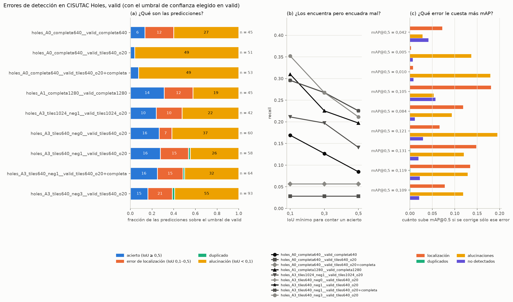
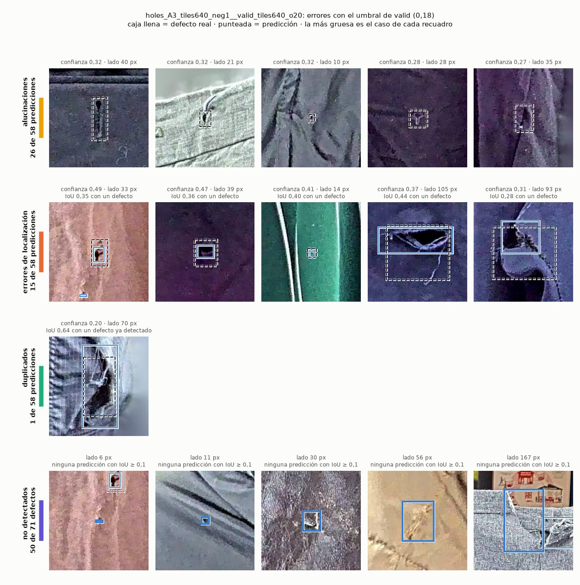

# Diagnóstico de errores del bloque A en CISUTAC (issue #5)

**Pregunta:** ¿por qué la A3 de Holes (`holes_A3_tiles640_neg1__valid_tiles640_o20`: YOLO11n con tiles de 640 px, 20 % de solapamiento y un tile sano por cada tile con agujero) tiene **mAP@0.5 = 0,131** en valid?

**Alcance:** sólo valid. El valid de Holes tiene **43 fotos y 71 agujeros**; el de Spots, 59 fotos y 284 manchas. Con muestras de este tamaño, diferencias de pocas centésimas entre corridas o entre tipos de error no son concluyentes. Las predicciones de test de `predicciones_bloque_a/spots/` (las que tienen `__test_` en el nombre) no se abrieron.

## Cómo regenerarlo

Desde la raíz del repo, con las fotos de CISUTAC en `data/` (ver `docs/DATASETS.md`):

```
# 1. Desglose, Δ mAP y figuras resumen (CSV y PNG)
python scripts/analyze_detection_errors.py --carpeta reports/cisutac/predicciones_bloque_a \
    --patron "*/*__valid_*" --salida reports/cisutac/errores
# 2. Controles adicionales (errores_controles.csv)
python scripts/detection_error_checks.py --carpeta reports/cisutac/predicciones_bloque_a \
    --patron "*/*__valid_*" --salida reports/cisutac/errores
# 3. Ejemplos visuales (una vez por corrida)
P=reports/cisutac/predicciones_bloque_a
for r in holes/holes_A3_tiles640_neg1__valid_tiles640_o20 holes/holes_A1_completa1280__valid_completa1280 \
         spots/spots_A3_tiles640_neg0__valid_tiles640_o20; do
  python scripts/plot_cisutac_predictions.py --dataset "${r%%/*}" --por-error --corrida "$P/$r" \
      --salida "reports/cisutac/errores/errores_${r##*/}_ejemplos.jpg"
done
```

El patrón `*/*__valid_*` deja afuera las carpetas de test sin abrirlas. Todo tarda alrededor de un minuto en CPU. Las predicciones son las del bloque A (ver `../predicciones_bloque_a/README.md`). Todos los números de este README salen de estos comandos, salvo los de la corrida de Kaggle (02b), que salen de su notebook ejecutado. En las 18 corridas de valid (9 de Holes y 9 de Spots) se comprobó que las cajas reales, el recall@0.5 y el mAP@0.5 coinciden con su `metricas.json`.

## Cómo leer las categorías

Siguen a TIDE (Bolya et al., ECCV 2020) y están implementadas en `src/detection_eval.py`. Con el umbral de confianza elegido en valid (0,18 en la A3), cada predicción es:

- **acierto:** IoU ≥ 0,5 con un agujero todavía libre;
- **error de localización** (caja mal encuadrada): IoU entre 0,1 y 0,5 con el agujero más cercano;
- **duplicado:** IoU ≥ 0,5 con un agujero que ya tomó otra predicción de mayor confianza;
- **alucinación:** IoU < 0,1 con todos los agujeros.

Un agujero es **no detectado** si ninguna predicción lo toca con IoU ≥ 0,1. El **Δ mAP** de cada error es cuánto subiría el mAP@0.5 si se corrigiera sólo ese error. Igual que el mAP, se calcula sin umbral y con las 100 predicciones más confiables por foto. Los Δ se superponen, así que no suman.

## Archivos

| Archivo | Contenido |
|---|---|
| `errores_predicciones.csv` | Por corrida: umbral, predicciones sobre el umbral y cuántas son aciertos, localización, duplicados y alucinaciones |
| `errores_defectos.csv` | Por corrida y tamaño (< 16, 16–32, ≥ 32 px y total): detectados, sólo con caja mala y no detectados; recall a IoU 0,1, 0,3 y 0,5 con IC 95 % |
| `errores_delta_map.csv` | mAP@0.5 de cada corrida y Δ mAP por tipo de error |
| `errores_controles.csv` | Controles adicionales por corrida: recall y estado de los defectos sin umbral, Δ de localización partido, confianzas, las 20 predicciones más confiables y detalle de los errores de localización |
| `errores_holes.png`, `errores_spots.png` | Composición de las predicciones, recall según el IoU exigido y Δ mAP |
| `errores_holes_por_tamano.png`, `errores_spots_por_tamano.png` | Estado de los defectos por lado equivalente, una corrida por panel |
| `errores_holes_A3_tiles640_neg1__valid_tiles640_o20_ejemplos.jpg` | Ejemplos de cada error en la A3 de Holes |
| `errores_holes_A1_completa1280__valid_completa1280_ejemplos.jpg` | Ídem en la mejor variante sin tiles, para separar lo que es propio de los tiles |
| `errores_spots_A3_tiles640_neg0__valid_tiles640_o20_ejemplos.jpg` | Ídem en la variante elegida en Spots |

## A3 de Holes: desglose

**Con el umbral de valid (0,18):**

| Predicciones sobre el umbral | Cantidad | % |
|---|---:|---:|
| Aciertos | 16 | 28 % |
| Errores de localización | 15 | 26 % |
| Duplicados | 1 | 2 % |
| Alucinaciones | 26 | 45 % |
| **Total** | **58** | |

| Agujeros reales | < 16 px | 16–32 px | ≥ 32 px | Total |
|---|---:|---:|---:|---:|
| Detectados | 2 | 5 | 9 | 16 (23 %) |
| Sólo con caja mala | 2 | 1 | 2 | 5 (7 %) |
| No detectados | 15 | 10 | 25 | 50 (70 %) |
| **Total** | **19** | **16** | **36** | **71** |

El recall es 0,296 a IoU 0,1, 0,268 a IoU 0,3 y 0,225 a IoU 0,5 (IC 95 %: 0,143–0,319).

**Cuánto mAP cuesta cada error:**

| Error corregido | Δ mAP@0.5 |
|---|---:|
| Localización | +0,148 |
| Alucinaciones | +0,120 |
| No detectados | +0,019 |
| Duplicados | +0,001 |



**Controles adicionales.** Salen de `scripts/detection_error_checks.py`, que usa las funciones de `src/detection_eval.py` sobre las mismas predicciones, y quedan en `errores_controles.csv`.

- **El modelo ve casi todos los agujeros.** Con las 100 predicciones más confiables por foto, 62 de los 71 agujeros (87 %) tienen alguna predicción con IoU ≥ 0,1 y 40 (56 %) una con IoU ≥ 0,5. Sólo 9 (13 %) no tienen ninguna cerca. De los 50 que figuran como no detectados con el umbral, 41 tienen una predicción cerca pero con confianza menor a 0,18.
- **De dónde sale el Δ de localización.** Corregir las cajas de los 22 agujeros que el modelo encuentra sólo con una caja mala vale +0,102, pero esas cajas tienen confianza mediana de 0,04 y sólo 3 superan el umbral. Quitar las cajas de más sobre agujeros ya acertados vale apenas +0,027. Estas dos correcciones se calcularon por separado; aplicadas juntas dan el +0,148.
- **No es un problema de cortes de tile.** Sólo 3 de las 15 cajas mal encuadradas que superan el umbral tocan un borde de tile. Además, la A1 1280, que usa la foto completa sin tiles, tiene un Δ de localización mayor (+0,181).
- **Las cajas buenas y las malas tienen la misma confianza.** Sobre el umbral, la mediana es 0,22 en los aciertos y 0,21 en las alucinaciones. Entre las 20 predicciones más confiables de todo valid hay 6 aciertos, 8 errores de localización y 6 alucinaciones.

**Qué muestran los ejemplos** (`errores_holes_A3_tiles640_neg1__valid_tiles640_o20_ejemplos.jpg`):

- **Alucinaciones:** ranuras y puntos oscuros, pliegues y marcas que se parecen a un agujero.
- **Errores de localización:** en agujeros chicos, la caja los rodea con un margen de más (IoU 0,35–0,40); en agujeros grandes, la caja abarca también los hilos deshilachados.
- **Duplicados:** hay un solo caso.
- **No detectados:** van de agujeros de 6 px a desgarros de 167 px, y hay zonas gastadas claras con poco contraste.



## Comparación entre variantes de Holes (valid)

| Corrida | mAP@0.5 | Δ localización | Δ duplicados | Δ alucinaciones | Δ no detectados |
|---|---:|---:|---:|---:|---:|
| A0 completa 640 | 0,042 | 0,072 | 0,000 | 0,028 | 0,041 |
| A0 evaluada con tiles 640 | 0,005 | 0,003 | 0,000 | 0,137 | 0,006 |
| A0 evaluada con tiles 640 + completa | 0,010 | 0,007 | 0,000 | 0,179 | 0,008 |
| A1 completa 1280 | 0,105 | 0,181 | 0,000 | 0,053 | 0,057 |
| A3 tiles 1024, neg 1 | 0,084 | 0,119 | 0,000 | 0,094 | 0,011 |
| A3 tiles 640, neg 0 | 0,121 | 0,066 | 0,000 | 0,195 | 0,029 |
| **A3 tiles 640, neg 1** | **0,131** | **0,148** | **0,001** | **0,120** | **0,019** |
| A3 tiles 640, neg 1 + completa | 0,119 | 0,134 | 0,001 | 0,129 | 0,022 |
| A3 tiles 640, neg 3 | 0,109 | 0,078 | 0,001 | 0,119 | 0,021 |

- En todas las A3 (entrenadas con tiles), las alucinaciones cuestan entre 0,09 y 0,20 de mAP y los no detectados 0,03 o menos.
- Pasar de neg 0 a neg 1 bajó el Δ de alucinaciones de 0,195 a 0,120 y subió el mAP de 0,121 a 0,131. Con neg 3, en cambio, el Δ de alucinaciones queda igual (0,119) y el mAP baja a 0,109: sumar más tiles sanos sorteados al azar no reduce las alucinaciones.
- Agregar la foto completa a los tiles suma 6 alucinaciones (de 26 a 32) y baja el mAP a 0,119.

## Causa principal

El mAP@0.5 bajo de la A3 **no se debe a que el modelo no vea los agujeros, sino a que su confianza no separa los aciertos de los errores**. Entre sus 100 predicciones más confiables por foto llega al 87 % de los agujeros. Sin embargo, los aciertos tienen la misma confianza que dos tipos de error:

1. alucinaciones sobre texturas que parecen agujeros (Δ +0,120);
2. agujeros encontrados con cajas mal encuadradas, casi siempre con confianza muy baja (Δ +0,148).

Los agujeros que ninguna predicción toca (Δ +0,019) y los duplicados (Δ +0,001) casi no pesan. Con 71 agujeros, la diferencia entre localización y alucinaciones es demasiado chica para decir cuál de los dos pesa más: son dos caras del mismo problema de confianza.

Tampoco es un efecto del corte en tiles: la A1 sin tiles tiene todavía más error de localización (Δ +0,181). Y no se arregla entrenando más, como muestra la corrida de Kaggle de la sección siguiente.

## Mejora propuesta: elegir el checkpoint con el mAP@0.5 por foto en valid

**Qué cambia.** Hoy el `best.pt` lo elige Ultralytics con su validación interna sobre 162 tiles de valid: 81 con agujero y 81 sanos sorteados al azar. En cambio, la evaluación recorre los 1.376 tiles de las 43 fotos, y 1.270 de ellos no tienen agujero (conteos de `build_tile_dataset` en el notebook 02b). El criterio que elige el modelo ve sólo 81 de esos 1.270 tiles sanos, que es justamente donde aparecen las alucinaciones. La propuesta es elegir el checkpoint con la misma métrica y la misma unidad con que se reporta: mAP@0.5 por foto en valid, con la inferencia por tiles de SAHI.

**Qué muestra la corrida de Kaggle** (`notebooks/ejecutados/02b_ejecutado_a3_extendida_holes.ipynb`). La 02b repitió la A3 con hasta 100 épocas. Para Ultralytics, la mejor época fue la última (mAP50 = 0,159 y mAP50-95 = 0,064 sobre sus 162 tiles). Evaluado por foto, ese modelo quedó peor que la A3 de 26 épocas:

| Métrica (por foto, valid) | A3 original | 02b |
|---|---:|---:|
| mAP@0.5 | 0,131 | 0,107 |
| AP_small | 0,077 | 0,031 |
| Recall | 0,225 | 0,197 |
| mAP@0.5:0.95 | 0,039 | 0,043 |

Entrenar más no mejoró la métrica que nos importa, y el criterio de selección de Ultralytics no lo detectó.

**Cómo probarla (sólo en valid; test sigue cerrado):**

1. Repetir la 02b sin cambiar nada (YOLO11n, tiles de 640, 20 % de solapamiento, neg 1, semilla 0, 100 épocas, paciencia 30), pero agregando `save_period=5` a `cb.train` para guardar un checkpoint cada 5 épocas. `cb.train` ya pasa ese argumento a Ultralytics con `**extra`, así que no hay que tocar `src/`.
2. Evaluar cada checkpoint con `cb.evaluate(..., split="valid", mode="tiles", tile=640, overlap=0.2)`. En la T4 de Kaggle son unos 20 s por checkpoint (0,45 s por foto × 43 fotos).
3. Quedarse con el checkpoint de mayor mAP@0.5 por foto y compararlo con la A3 (0,131) y la 02b (0,107). Además, correr este mismo análisis sobre sus predicciones para ver si bajó el Δ de alucinaciones.
4. Test se abre una sola vez, después de congelar la variante, como pide `reports/protocolo_experimental.md`.

**Si se elige el checkpoint mirando valid, el número de valid queda optimista** (es el mejor de unos 20 checkpoints medidos sobre sólo 43 fotos). **El resultado que vale es el del test del issue #7.**

Si esta selección no mejora la A3, el siguiente candidato es entrenar con tiles sanos *difíciles* (los que generan alucinaciones en train) en lugar de sorteados, porque la neg 3 muestra que sumar tiles sanos al azar no alcanza.

**Por qué no cambiar la fusión de SAHI.** Una opción sería unir con NMS por IoS las cajas que envuelven a un acierto. Se descartó por dos motivos. Quitar esas cajas vale como mucho +0,027 de mAP. Además, de las 9 cajas sobre el umbral que caen sobre un acierto, 8 son más grandes que él y 5 tienen más confianza, así que en esos 5 casos un NMS conservaría la caja equivocada.

## Comparación con Spots

En la variante elegida para Spots (`spots_A3_tiles640_neg0__valid_tiles640_o20`, mAP@0.5 = 0,039):

- Hay 271 predicciones sobre el umbral (0,09): 37 aciertos, 41 errores de localización, 2 duplicados y 191 alucinaciones (70 %).
- Los Δ son: alucinaciones +0,093, localización +0,053, no detectados +0,031 y duplicados +0,000.

La diferencia con Holes es que en Spots **sí hay manchas que el modelo no encuentra**. Aun sin umbral, 132 de las 284 manchas (46 %) no tienen ninguna predicción cerca, contra el 13 % de los agujeros. Además, las cajas mal encuadradas son más chicas que la mancha (mediana de 0,54 veces su área): son fragmentos de manchas grandes. La selección por mAP por foto también aplica a Spots, porque las alucinaciones dominan, pero no resolvería las manchas no encontradas.

## Limitaciones

- La muestra es de 43 fotos y 71 agujeros, y los Δ mAP no tienen intervalo de confianza.
- El umbral de 0,18 también se eligió en valid, así que el desglose con umbral es optimista.
- Algunas alucinaciones podrían ser agujeros sin etiquetar. No se verificó, porque no agregamos etiquetas propias.
- Las predicciones de la 02b no están en `predicciones_bloque_a/`, así que sus errores no se pudieron desglosar; de esa corrida sólo se usan las métricas del notebook ejecutado.
