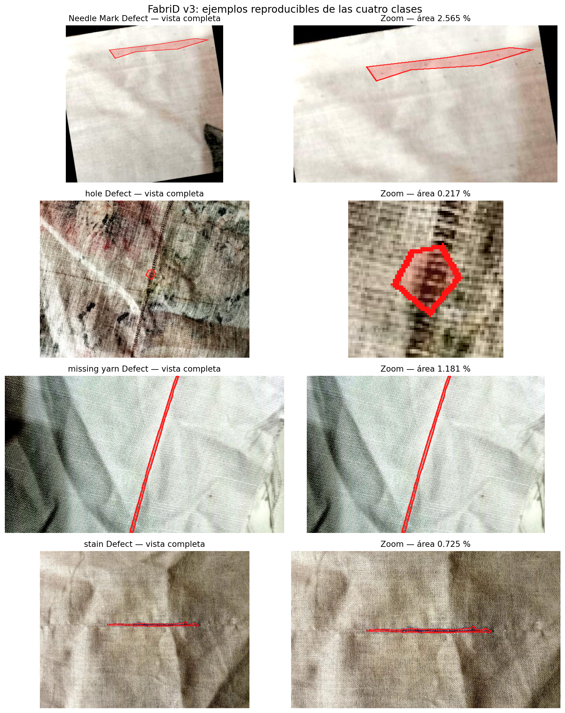
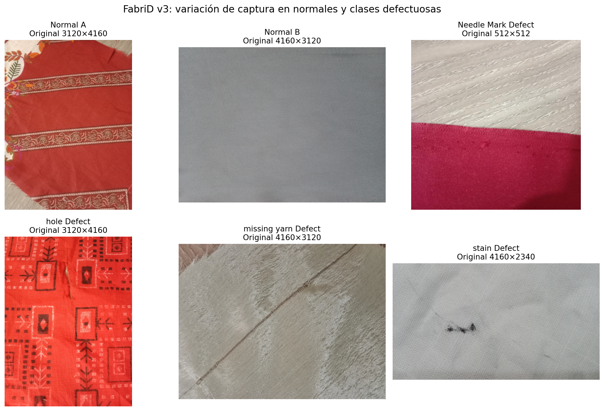
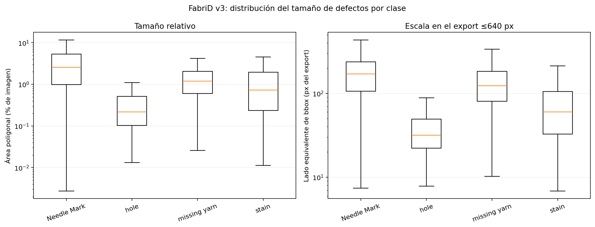
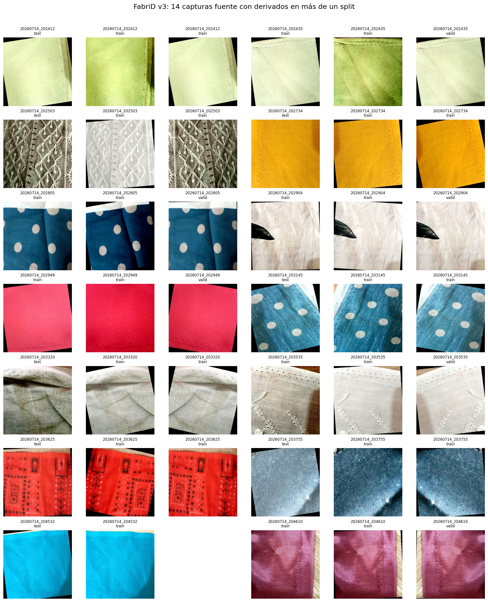
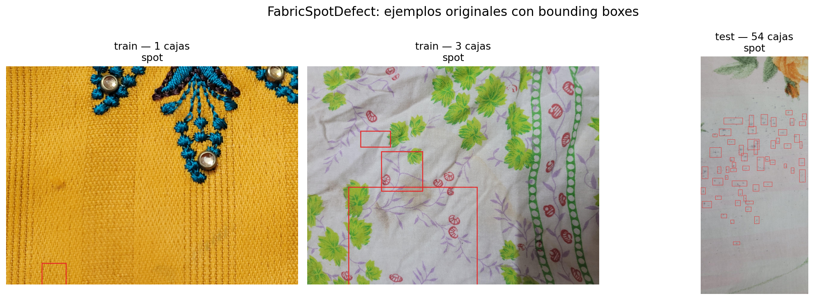

# EDA FabriD v3 y control de FabricSpotDefect — Integrante 3

**Fecha:** 11/11/2026  
**Alcance:** tareas FAB-1 a FAB-6 y FSD-1 del plan común. Se analizaron los archivos originales y los exports existentes sin modificar imágenes, anotaciones ni particiones. No se entrenó ningún modelo.

## Resumen ejecutivo

FabriD v3 permite una comparación controlada entre segmentación supervisada y PatchCore, pero **no debe usarse con los splits y normales sin depurar**. El EDA encontró tres condiciones:

1. Las 14 capturas que aparecían en varios splits no son coincidencias de nombre: son 41 derivados visualmente relacionados, con flips, cambios de contraste o encuadre. El manifiesto propuesto los agrupa por `source_id` y mueve 27 derivados de train hacia el split de evaluación donde ya estaba su captura.
2. La diferencia 620/613 se resuelve en **607 normales concordantes**, 13 originales catalogados como normales pero anotados con polígonos y 6 etiquetas vacías sin original normal correspondiente. Los 19 casos ambiguos se excluyen del protocolo común.
3. Hay un posible atajo de captura: 372 de las 467 imágenes originales de `Needle Mark Defect` son 512×512, mientras que ninguna normal tiene esa resolución. Fechas/lotes y resoluciones también varían por clase.

Con estas restricciones, el test común propuesto contiene 85 normales concordantes y 278 defectuosas anotadas. Ambos enfoques podrán evaluarse sobre las mismas imágenes mediante mapas binarios de anomalía y métricas compatibles.

FabricSpotDefect queda como complemento supervisado para manchas. Aunque COCO declara las categorías `Hole-EnBF` y `spot`, las **3.288 anotaciones reales pertenecen a `spot`**; `Hole-EnBF` tiene cero instancias y funciona como categoría/supercategoría no utilizada. No aporta un benchmark de agujeros ni normales verificadas.

## FAB-1 — Esquema, clases y anotaciones

### Originales

| Carpeta original | Imágenes | Modo | Resolución predominante |
|---|---:|---|---|
| `defect free` | 620 | RGB | 4160×3120 (245) |
| `Needle Mark Defect` | 467 | RGB | 512×512 (372) |
| `hole Defect` | 459 | RGB | 4160×3120 (244) |
| `missing yarn Defect` | 454 | RGB | 4160×3120 (257) |
| `stain Defect` | 407 | RGB | 4160×3120 (111) |
| **Total** | **2.407** | RGB | Heterogénea: 512×512 a 4160×3120 |

### Export anotado

El export de Roboflow contiene las mismas 2.407 entradas, auto-orientadas, con contraste ajustado y redimensionadas para caber dentro de 640×640 sin deformar la relación de aspecto. Las anotaciones son polígonos normalizados en formato YOLO-seg de cuatro clases:

- `Needle Mark Defect`
- `hole Defect`
- `missing yarn Defect`
- `stain Defect`

| Split oficial | Imágenes | Etiquetas vacías | Con defecto | Instancias |
|---|---:|---:|---:|---:|
| train | 1.685 | 431 | 1.254 | 1.714 |
| valid | 364 | 94 | 270 | 395 |
| test | 358 | 88 | 270 | 393 |
| **Total** | **2.407** | **613** | **1.794** | **2.502** |

La licencia declarada en el export es **CC BY 4.0**. Datos reproducibles: [`fab1_inventario_original.csv`](fab1_inventario_original.csv) y [`fab1_export_splits.csv`](fab1_export_splits.csv).

## FAB-2 — Ejemplos y sesgo de captura

La primera figura muestra un caso cercano a la mediana del área de cada clase, con el polígono superpuesto y un zoom. Los agujeros suelen ser compactos; las marcas de aguja y los hilos faltantes pueden ser largos y delgados, por lo que un único tamaño de caja no describe completamente la dificultad.



La segunda figura compara originales normales y defectuosos. Hay cambios marcados de tela, fondo, color, escala, encuadre y resolución.



El control numérico confirma un riesgo de atajo:

- 372/467 imágenes de `Needle Mark Defect` son 512×512; las restantes cuatro categorías no contienen originales 512×512.
- Los normales provienen de los lotes/fechas 20260505, 20260714 y 20260803.
- `stain Defect` incluye 20260722, ausente en normales; `hole` y `missing yarn` incluyen 20260506, mientras que los normales equivalentes están fechados 20260505.

Por lo tanto, una alta métrica puede reflejar diferencias de lote o captura además del defecto. El split agrupado por fuente evita derivados cruzados, pero **no elimina por completo el confusor de lote**. Los resultados deben desglosarse por fecha/resolución cuando sea posible y no presentarse como generalización a telas no vistas.

Datos reproducibles: [`fab2_contexto_captura.csv`](fab2_contexto_captura.csv).

## FAB-3 — Áreas y tamaños por clase

| Clase | Instancias | Área p10 (%) | Área p50 (%) | Área p90 (%) | Lado bbox p50 (px export) | Bajo 1 % |
|---|---:|---:|---:|---:|---:|---:|
| Needle Mark | 636 | 0,1231 | 2,5487 | 8,0357 | 170,64 | 25,3 % |
| hole | 568 | 0,0559 | 0,2171 | 1,1911 | 31,56 | 87,5 % |
| missing yarn | 580 | 0,3138 | 1,1810 | 3,4245 | 123,18 | 43,6 % |
| stain | 718 | 0,1077 | 0,7247 | 4,0742 | 60,02 | 58,5 % |
| **Total** | **2.502** | **0,0948** | **0,9046** | **4,7679** | **83,75** | **53,2 %** |

Los agujeros son la clase más pequeña: su polígono mediano ocupa 0,217 % del export y 87,5 % está por debajo de 1 %. El lado equivalente de bbox se mide en las imágenes del export de hasta 640 px; no debe confundirse con la escala del original de alta resolución.



Datos reproducibles: [`fab3_tamanos_clase.csv`](fab3_tamanos_clase.csv).

## FAB-4 — Las 14 capturas repetidas y el split agrupado

Se confirmaron 14 `source_id` presentes en más de un split:

- 8 grupos cruzaban train/test.
- 6 grupos cruzaban train/valid.
- Trece grupos contienen tres derivados y uno contiene dos: **41 imágenes en total**.
- Ningún par es idéntico byte a byte, pero las vistas muestran la misma tela y estructura de defecto bajo flips, contraste o encuadres relacionados.



Tratarlos como observaciones independientes permitiría que el modelo vea en train una transformación de una captura evaluada después. El manifiesto derivado aplica una regla conservadora y determinística:

1. agrupar todos los derivados por el nombre anterior a `.rf.`;
2. si el grupo ya contiene test, asignar todo el grupo a test;
3. en caso contrario, si contiene valid, asignarlo completo a valid;
4. mantener en train los grupos que sólo estaban en train.

Esto preserva los casos de evaluación oficiales y retira sus derivados de train: mueve 15 imágenes de train a test y 12 de train a valid.

| Split propuesto | Imágenes | Fuentes únicas | Movidas desde train |
|---|---:|---:|---:|
| train | 1.658 | 1.468 | 0 |
| valid | 376 | 364 | 12 |
| test | 373 | 358 | 15 |

No quedan `source_id` compartidos entre splits. El manifiesto no mueve ni reescribe los archivos originales: [`fab4_split_agrupado.csv`](fab4_split_agrupado.csv). La evidencia de los 14 grupos está en [`fab4_fuentes_repetidas.csv`](fab4_fuentes_repetidas.csv).

## FAB-5 — Conciliación de normales

La diferencia entre 620 originales `defect free` y 613 etiquetas vacías no se debe a siete archivos simplemente perdidos:

| Relación | Cantidad | Tratamiento |
|---|---:|---|
| Original `defect free` + etiqueta vacía con mismo `source_id` | **607** | Normal concordante |
| Original `defect free` + polígono en export | **13** | Ambiguo; excluir |
| Etiqueta vacía sin original `defect free` | **6** | Ambiguo; excluir |

Entre los 13 conflictos hay anotaciones de las cuatro clases. De los seis vacíos adicionales, dos nombres aparecen en carpetas originales defectuosas y cuatro no tienen original correspondiente. Ninguno se debe usar como normal confiable sólo porque su `.txt` esté vacío.

La lista exacta y su tratamiento está en [`fab5_conciliacion_normales.csv`](fab5_conciliacion_normales.csv); el resumen, en [`fab5_normales_resumen.csv`](fab5_normales_resumen.csv).

## FAB-6 — Comparación supervisado vs. PatchCore

### Conjunto común propuesto

El manifiesto agrupado y la exclusión de los 19 ambiguos producen:

| Split | Normales concordantes | Defectuosas anotadas | Ambiguas excluidas |
|---|---:|---:|---:|
| train | 429 | 1.221 | 8 |
| valid | 93 | 282 | 1 |
| test | 85 | 278 | 10 |

Protocolo preliminar:

1. **PatchCore:** entrenar exclusivamente con las 429 normales concordantes de train.
2. **Segmentador supervisado:** entrenar con las 1.221 defectuosas y sus polígonos, incorporando las 429 normales como máscaras vacías cuando la implementación lo admita.
3. Usar valid para elegir umbrales, transformaciones y agregación a nivel imagen; no mirar test para seleccionar configuraciones.
4. Evaluar ambos sobre exactamente las mismas 363 imágenes no ambiguas de test: 85 normales y 278 defectuosas.
5. Para la comparación binaria, unir las cuatro clases supervisadas en una máscara `defecto` y comparar **AUROC imagen, AUROC píxel y AUPRO**. Si se fija umbral en valid, agregar Dice/IoU binarios.
6. Reportar además IoU/Dice por clase para el segmentador, pero no comparar directamente esos valores multiclase con el AUROC de PatchCore.
7. La unidad independiente es `source_id`, no cada derivado `.rf.`. Los intervalos de confianza o bootstrap deben agruparse por esa fuente.

Conclusión: la comparación es **viable con limitaciones**. Comparte datos y métricas, pero el sesgo de lote/resolución impide extrapolar el resultado a prendas usadas o a nuevos contextos de captura.

Datos reproducibles: [`fab6_protocolo_conteos.csv`](fab6_protocolo_conteos.csv).

## FSD-1 — Control acotado de FabricSpotDefect

| Elemento | Resultado |
|---|---|
| Originales | 1.014: 643 train, 219 valid, 152 test |
| Anotaciones originales | 3.288 |
| Categorías COCO declaradas | `Hole-EnBF`, `spot` |
| Categorías realmente anotadas | `spot`: 3.288; `Hole-EnBF`: 0 |
| Segmentaciones no vacías | 200 |
| Resto de anotaciones | Principalmente bounding boxes |
| Train sin anotaciones | 36; no están verificadas como normales |
| Export aumentado COCO | 2.300 imágenes de 416×416 |
| Export aumentado YOLO | Los mismos 2.300 ejemplos fuente en otra representación |



Los 2.300 archivos aumentados no se suman dos veces: COCO y YOLO contienen el mismo multiconjunto de ejemplos fuente, aunque los JPEG fueron exportados/recomprimidos por separado. En cada representación hay 1.929 train, 219 valid y 152 test; train equivale a tres variantes por cada uno de sus 643 originales, mientras valid y test conservan una por fuente.

Recomendación:

- usar sólo los originales para validación y test;
- si se usan las variantes aumentadas, restringirlas a train y agruparlas por fuente;
- no usar las 36 imágenes sin cajas como normales de PatchCore sin verificación adicional;
- considerar FabricSpotDefect sólo como complemento supervisado de **manchas**. No aporta una segunda clase de agujeros utilizable y su localización es mayormente por cajas.

Datos reproducibles: [`fsd1_resumen.csv`](fsd1_resumen.csv).

## Decisiones y limitaciones

- **FabriD:** conservar como segundo dominio industrial y comparación supervisado/anomalías, usando el manifiesto agrupado y sólo normales concordantes.
- **FabricSpotDefect:** complemento opcional para manchas; no es núcleo del experimento ni fuente de normales.
- El `source_id` se deriva del nombre anterior a `.rf.`. La inspección de los 14 conflictos confirma que funciona para los derivados conocidos, pero podrían existir capturas relacionadas con timestamps distintos que este criterio no detecta.
- La diferencia de lotes, fondos y resoluciones de FabriD es un posible confusor. Debe declararse aun si las métricas son altas.
- La propuesta es un manifiesto experimental pendiente de aprobación grupal; no altera la distribución oficial en disco.
- Este EDA no demuestra que PatchCore o el segmentador funcionen: deja una comparación reproducible para la etapa posterior.

## Reproducción

Desde la raíz del repositorio:

```bash
REWEAR_DATA_DIR=/ruta/a/final_dataset/data python3 scripts/generate_fabrid_eda.py
```

El script escribe exclusivamente en `reports/fabrid/`. El resumen estructurado queda en [`fab_summary.json`](fab_summary.json).

**Fuentes:** [FabriD v3](https://data.mendeley.com/datasets/vncdwps24r/3) y [FabricSpotDefect](https://data.mendeley.com/datasets/6574nhzm8x/1).
