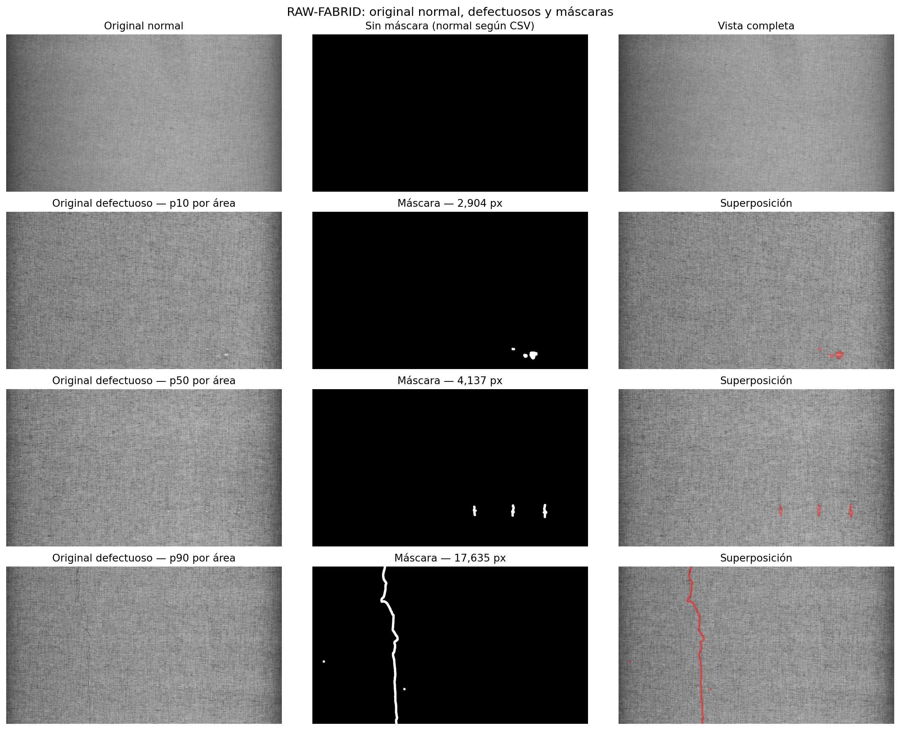
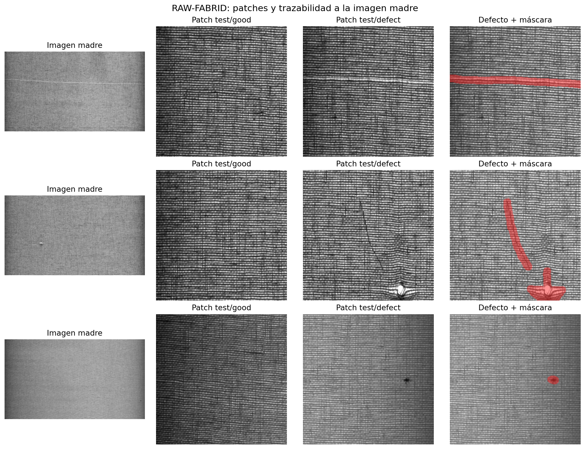
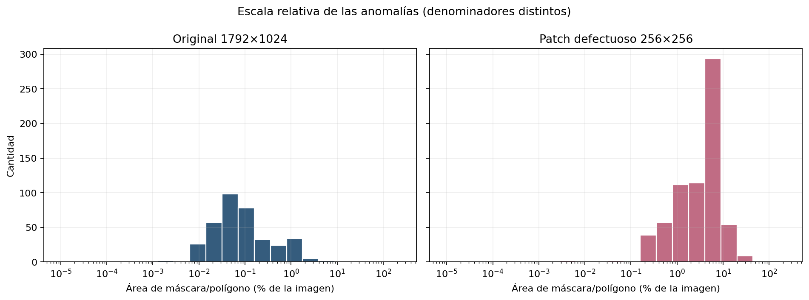

# EDA RAW-FABRID — Integrante 2

**Fecha:** 11/11/2026  
**Alcance:** tareas RAW-1 a RAW-6 del plan común. Este análisis sólo leyó los originales y generó tablas y figuras derivadas; no modificó imágenes, etiquetas ni particiones, y no entrenó modelos.

## Resumen ejecutivo

RAW-FABRID es adecuado como benchmark principal de detección de anomalías a nivel de **patch**: ofrece 14.196 patches normales para entrenamiento, 4.969 patches normales y 687 defectuosos para prueba, y máscaras de píxel para los defectuosos. La separación de imágenes madre entre train y test es correcta.

Hay, sin embargo, dos precauciones metodológicas importantes:

1. Los 5.656 patches de test no son observaciones independientes: provienen de sólo **202 imágenes madre**, y los patches `test/good` y `test/defect` comparten esas mismas madres.
2. El benchmark oficial no permite por sí solo calcular un AUROC honesto a nivel de imagen original: las 202 madres de test son defectuosas, mientras que las 507 madres totalmente normales se usan en train.

Por eso se recomienda usar el protocolo oficial como evaluación primaria a nivel de patch y agrupar la incertidumbre por imagen madre. Como evaluación auxiliar a nivel de original, primero habría que reservar madres normales completas mediante un manifiesto estratificado por rollo, antes de entrenar.

## RAW-1 — Inventario y canales

| Unidad | Cantidad | Observación |
|---|---:|---|
| Imágenes originales | 709 | PNG, 1792×1024 |
| Originales normales | 507 | Según CSV high-res |
| Originales defectuosas | 202 | Según CSV high-res |
| Máscaras high-res | 204 | Dos son huérfanas |
| Anotaciones high-res | 361 | Bounding box y polígono COCO |
| Patches totales | 19.852 | Todos de 256×256 |
| `train/good` | 14.196 | Proceden de 507 madres normales |
| `test/good` | 4.969 | Proceden de 202 madres defectuosas |
| `test/defect` | 687 | Proceden de las mismas 202 madres |
| Máscaras de patch | 687 | Una por patch defectuoso |
| Anotaciones COCO de patches | 782 | Puede haber más de una instancia por patch |

Los siete rollos contienen originales normales y defectuosos:

| Rollo | Originales | Normales | Defectuosas | Instancias |
|---|---:|---:|---:|---:|
| Rollo1A | 87 | 66 | 21 | 23 |
| Rollo2A | 82 | 55 | 27 | 48 |
| Rollo3A | 20 | 13 | 7 | 17 |
| Rollo4A | 170 | 92 | 78 | 155 |
| Rollo5A | 33 | 18 | 15 | 38 |
| Rollo6A | 124 | 96 | 28 | 35 |
| Rollo7A | 193 | 167 | 26 | 45 |

PIL informa modo **RGB**. En una muestra determinística estratificada de 70 originales —diez por rollo— los 70 tienen los tres canales idénticos píxel a píxel. La evidencia indica que son imágenes monocromáticas almacenadas en RGB; el resultado se limita a la muestra auditada y no se extrapola como comprobación exhaustiva de los 709 archivos.

Datos reproducibles: [`raw1_inventario.csv`](raw1_inventario.csv), [`raw1_rollos.csv`](raw1_rollos.csv) y [`raw1_canales_muestra.csv`](raw1_canales_muestra.csv).

## RAW-2 — Ejemplos y relación con la imagen madre

La primera figura incluye un original normal y selecciona defectos próximos a los percentiles 10, 50 y 90 del área poligonal high-res; para estos últimos muestra el original, la máscara completa y la superposición. Una máscara puede contener varias instancias; el percentil se utiliza para elegir la imagen, no para afirmar que todos sus píxeles pertenecen a una sola instancia.



La segunda figura vincula cada patch con su `parent_raw`. Para una misma madre defectuosa aparecen patches localmente sanos en `test/good` y patches con anomalía en `test/defect`. Esto es coherente con una tarea local a nivel de patch, pero no convierte a `test/good` en un conjunto de imágenes originales sanas.



## RAW-3 — Escala de las anomalías

| Medida | n | p10 | p50 | p90 |
|---|---:|---:|---:|---:|
| Defectos por original defectuosa | 202 | 1 | 1 | 3 |
| Ancho de bbox high-res (px) | 361 | 19 | 45 | 916 |
| Alto de bbox high-res (px) | 361 | 17 | 43 | 156 |
| Lado equivalente de bbox high-res (px) | 361 | 19,49 | 47,29 | 256,92 |
| Área de bbox high-res (px²) | 361 | 380 | 2.236 | 66.008 |
| Área de polígono high-res (px²) | 361 | 290 | 1.272,5 | 16.157,5 |
| Área de polígono / original (%) | 361 | 0,0158 | 0,0693 | 0,8805 |
| Área de máscara / patch (%) | 687 | 0,5145 | 4,2740 | 8,4366 |

La mediana del defecto ocupa sólo **0,069 %** del original high-res, pero **4,274 %** del patch defectuoso. Esta diferencia no significa que el defecto físico haya crecido: cambia el denominador y la construcción de los patches defectuosos los centra o desplaza hacia la anomalía. Los patches hacen que la señal sea más visible para un método local; los originales conservan el contexto y son necesarios para una evaluación de captura completa.



Datos reproducibles: [`raw3_cuantiles.csv`](raw3_cuantiles.csv).

## RAW-4 — Discrepancia entre 202 defectuosas y 204 máscaras

La discrepancia queda resuelta: existen dos máscaras no vacías sin imagen ni metadatos asociados.

| Archivo | Píxeles no cero | En `images/` | En CSV | En COCO | Tratamiento recomendado |
|---|---:|:---:|:---:|:---:|---|
| `Rollo2A_0000031_D_07-05-2024_10-39-06.546.png` | 116.837 | No | No | No | Excluir de experimentos; conservar el archivo original |
| `Rollo2A_0000032_D_07-05-2024_10-39-07.598.png` | 25.727 | No | No | No | Excluir de experimentos; conservar el archivo original |

No son máscaras vacías ni casos de `has_defect` mal codificado: son **máscaras huérfanas**. Las 202 originales marcadas como defectuosas sí tienen su máscara. No corresponde inventar las dos imágenes faltantes ni cambiar las etiquetas oficiales.

Datos reproducibles: [`raw4_discrepancia_202_204.csv`](raw4_discrepancia_202_204.csv).

## RAW-5 — Trazabilidad, dependencia y riesgo de fuga

| Tipo | Patches | Madres únicas |
|---|---:|---:|
| `train_good` | 14.196 | 507 |
| `test_good` | 4.969 | 202 |
| `test_defect` | 687 | 202 |

Intersecciones de madres:

| Pares | Madres compartidas | Interpretación |
|---|---:|---|
| `train_good` / `test_good` | 0 | Sin fuga de madre train–test |
| `train_good` / `test_defect` | 0 | Sin fuga de madre train–test |
| `test_good` / `test_defect` | 202 | Dependencia esperable dentro de test |

Cada original genera 28 patches: una madre normal aporta 28 patches `train/good`; una madre defectuosa aporta 28 patches repartidos entre `test/good` y `test/defect`. Los patches defectuosos no siempre son una cuadrícula fija: algunos se desplazan para incluir o centrar la anomalía.

La separación por madre evita una fuga directa entre train y test. Aun así:

- varios patches de una misma madre comparten textura y contexto, por lo que no deben contarse como 5.656 observaciones independientes para intervalos de confianza;
- los siete rollos aparecen tanto en train como en test, de modo que el protocolo mide generalización a nuevas capturas de rollos conocidos, no a un rollo industrial completamente nuevo;
- `test/good` contiene zonas localmente sanas de originales defectuosas, no negativos a nivel de captura completa.

Los intervalos de confianza y el bootstrap deben agruparse por `parent_raw`; además conviene reportar resultados estratificados por `roll_id` para detectar variación entre rollos.

Datos reproducibles: [`raw5_trazabilidad.csv`](raw5_trazabilidad.csv), [`raw5_intersecciones.csv`](raw5_intersecciones.csv) y [`raw5_trazabilidad_rollos.csv`](raw5_trazabilidad_rollos.csv).

## RAW-6 — Protocolo preliminar para PatchCore

### Evaluación primaria: benchmark oficial a nivel de patch

1. Entrenar PatchCore exclusivamente con los **14.196 patches `MVTec/train/good`** provenientes de 507 madres normales.
2. Evaluar sobre **4.969 `MVTec/test/good` + 687 `MVTec/test/defect`**.
3. Reportar **AUROC de anomalía a nivel de patch**. La unidad de predicción es el patch, pero la incertidumbre se estima agrupando por madre.
4. Usar las 687 máscaras para **AUROC de píxel** y **AUPRO**, indicando implementación y normalización exactas.
5. Reportar resultados por rollo y un intervalo de confianza mediante bootstrap de `parent_raw`, sin mezclar parches de una misma madre entre remuestreos.
6. Seleccionar umbral, normalización y cualquier hiperparámetro sólo con una validación derivada de madres de entrenamiento; el test oficial no se usa para ajustar decisiones.

### Evaluación auxiliar: nivel de imagen original

El split provisto no tiene originales normales independientes en test. Para calcular AUROC a nivel de original se propone, **antes de entrenar**, crear un manifiesto derivado que:

1. reserve madres normales completas, estratificadas por rollo, para validación/test;
2. mantenga todos los patches de una misma madre en una sola partición;
3. conserve las 202 madres defectuosas para test, sin usar sus patches localmente sanos como entrenamiento;
4. aplique PatchCore al original mediante una cuadrícula o ventana deslizante determinística;
5. agregue scores de patch a original mediante máximo o un percentil alto elegido en validación;
6. evalúe AUROC a nivel de original y localización con las máscaras high-res.

Un esquema *leave-one-roll-out* puede agregarse como prueba de generalización de dominio, pero no debe reemplazar al benchmark principal: responde una pregunta más exigente y cambia la distribución de entrenamiento.

## Limitaciones y decisiones para el equipo

- La licencia indicada por la fuente es **CC BY 4.0**; el uso requiere atribución.
- No se verificó independencia física entre capturas consecutivas de un mismo rollo; `parent_raw` es la agrupación mínima segura y `roll_id` debe conservarse para análisis estratificado.
- Las dos máscaras huérfanas quedan excluidas de los experimentos, pero no se borran.
- La tarea oficial es de anomalía local a nivel de patch. Una afirmación a nivel de rollo o captura completa requiere el protocolo auxiliar y una agregación definida previamente.
- Este EDA no demuestra el rendimiento de PatchCore; deja listo un protocolo evaluable y sin fuga directa de imagen madre.

## Reproducción

Desde la raíz del repositorio:

```bash
REWEAR_DATA_DIR=/ruta/a/final_dataset/data python3 scripts/generate_raw_fabrid_eda.py
```

El script usa un backend no interactivo para las figuras y escribe sólo bajo `reports/raw_fabrid/`. El resumen estructurado completo queda en [`raw_summary.json`](raw_summary.json).

**Fuente del dataset:** [RAW-FABRID en Mendeley Data](https://data.mendeley.com/datasets/db6g85xsyg/1).
